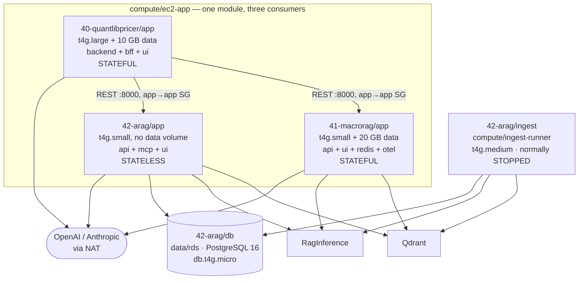

# `40` / `41` / `42` — the application tiers

← [Shared services](infra-walkthrough-shared-services.md) · up:
[Walkthrough](infrastructure-walkthrough.md) · next:
[Scheduling & observability →](infra-walkthrough-scheduling-observability.md)

Three applications, all on the same pattern: a private-subnet Graviton EC2 instance
running a Docker Compose stack, administered only through SSM. They differ in size, in
whether they keep local state, and in what they call.



---

## 1. `compute/ec2-app` — the workhorse

Module: [`compute/ec2-app`](../../infra/modules/compute/ec2-app/README.md) ·
[`main.tf`](../../infra/modules/compute/ec2-app/main.tf)

One module, three consumers. It creates the instance, its IAM role and instance
profile, an optional data volume, an optional Cloud Map registration, and an optional
start/stop schedule. The **security group is not created here** — it comes from
`networking/security-groups`, so tiers reference each other by group id rather than
every app inventing its own rules.

### The posture, which is identical for all three tiers

- **Private subnet, `associate_public_ip_address = false`.** No public address at all,
  so no public IPv4 charge either.
- **No key pair, no SSH rule.** Session Manager only — the agent dials outbound and
  needs no inbound rule.
- **IMDSv2 required**, and the hop limit is a per-tier decision:
  `http_put_response_hop_limit = 1` stops a container reaching instance metadata and
  assuming the instance role (the standard container-escape-to-credentials path). It is
  raised to 2 **only** where a container legitimately needs the instance role — i.e. it
  runs boto3, and the docker bridge adds a hop. MacroRAG needs 2 (its app container
  reads the corpus from S3); XbrlRag and Faultline stay at 1.
- **Root volume CMK-encrypted**, `ebs_optimized = true`.
- **`ignore_changes = [ami]`** — a newer AL2023 release must not replace a running
  application host on an unrelated plan. Patching is in-place via SSM; an AMI refresh is
  a deliberate taint-and-replace.
- **`monitoring = false`** — detailed monitoring is $2.10/instance/month for 1-minute
  rather than 5-minute metrics, on a host stopped 14 hours a day.

### The role can read *its own* things and nothing else

Every grant is ARN-scoped and conditional on the input being non-empty:

| Statement | Scope |
|---|---|
| `EcrLogin` | `ecr:GetAuthorizationToken` on `*` — it mints a registry-wide token and accepts no resource |
| `EcrPullOwnImagesOnly` | `BatchGetImage`/`GetDownloadUrlForLayer` on the listed repository ARNs |
| `ReadOwnSecretsOnly` | `GetSecretValue` on the listed secret ARNs (+ the RDS managed secret) |
| `ListOwnBucketsOnly` / `ReadWriteOwnObjectsOnly` | list on the bucket ARN, object ops on `<arn>/*` |
| `ReadDeployBundleOnly` | list + `GetObject` **only** — for a stateless tier fetching its bundle from a bucket it does not own |
| `DecryptViaServices` | `kms:Decrypt`/`GenerateDataKey*` on the one CMK |

Note that the pull scope is per-repository, not "all of ECR". MacroRAG's host lists four
repositories (its app, its UI, and the two mirrored sidecars) out of the twelve in the
shared ECR component; XbrlRag lists two; Faultline lists three. Likewise
`secret_arns` names the **one** secret that host consumes — passing
`values(dependency.secrets.outputs.secret_arns)` would grant every application's role
read on every other application's credentials, which is a cross-subsystem leak. There
are negative tests asserting a host cannot read another application's secret.

`ListBucket` and the object grant are split because `s3:ListBucket` does not accept an
object-level ARN. S3 object encryption rides the same CMK through the
`DecryptViaServices` grant, so no separate key wiring is needed.

### The bootstrap is a systemd unit, not one-shot cloud-init

This is the single most important operational detail in the module.

```
FIRST BOOT ONLY (cloud-init, from user_data):
  install docker + compose plugin + AWS CLI
  format & fstab-mount the data volume (by LABEL)
  write /opt/app/.env            ← host-static, non-secret config (runtime_env)
  write /usr/local/bin/app-deploy.sh
  write + enable app.service
  touch /var/log/app-bootstrap-status

EVERY BOOT (app.service, a systemd oneshot):
  aws s3 sync  <bundle_uri> /opt/app/bundle     ← compose file + configs
  render the app secret  → /opt/<app>/.env      ← 0600, re-fetched each boot
  append the RDS managed secret's fields        ← so a rotated password is picked up
  aws ecr get-login-password | docker login
  docker compose --env-file /opt/app/.env \
                 --env-file /opt/app/bundle/deploy.env \    ← image TAGS live here
                 -f <compose_file> pull && up -d
```

`cloud-init` runs on **first boot only**, and these instances are stopped and started
daily for cost. So the deploy work must happen on **every** boot, which is why it lives
in the systemd unit. Anything one-shot works on day one and silently does nothing on day
two — the same trap the NAT instance's iptables rules avoid.

Re-pulling images on every start is fine and deliberate: in-region ECR pulls are free
*and* bypass the NAT via the S3 gateway endpoint, because image layers live in S3. The
bundle sync rides the same endpoint.

The secret is **re-fetched on every boot**, which is what makes credential rotation a
`systemctl restart` rather than an image rebuild or a reprovision.

### Image tags live in S3, not in Terraform

This is provisioning principle 6, and it is the rule most worth internalising.

> **Updating an application image must never replace, recreate, or reprovision the
> infrastructure that runs it.** Rolling out a new container version is a *deploy*;
> creating the host, role, volume and network is a *provision*.

Concretely: the instance carries `user_data_replace_on_change = true`, so **anything
rendered into `user_data` replaces the box when it changes** — taking its local state
(staged data, caches, scratch volumes) with it. An image tag in a `local`, a tfvars, or
`runtime_env` would therefore make `terraform apply` the deploy mechanism, and every
version bump a host rebuild.

So the split is:

| Where | What | Changing it means |
|---|---|---|
| `user_data` via `runtime_env` | host-static config — endpoints, bucket names, secret paths, deploy mode | **replaces the instance** (rare, and intended) |
| S3 bundle `deploy.env` via `deploy_env_relpath` | the image tags | upload + `systemctl restart app.service`. **No Terraform.** |

`app-deploy.sh` passes the bundle's env-file as a *second* `--env-file` after
`/opt/app/.env`, so its tags override the placeholders. Rolling out a new image needs no
IAM change either — the role already reads the bundle.

```powershell
# 0. commit first, so the tag records exactly what runs
cd <xbrlrag-checkout>
$REGISTRY = "<acct>.dkr.ecr.us-east-1.amazonaws.com"
$TAG = "arm64-$(git rev-parse --short HEAD)"

aws ecr get-login-password --region us-east-1 | docker login --username AWS --password-stdin $REGISTRY

# 1. build + push EVERY image the compose stack runs, all on the SAME tag
docker buildx build --platform linux/arm64 --push -f infra/docker/Dockerfile -t "$REGISTRY/genai-dev/arag:$TAG" .
docker buildx build --platform linux/arm64 --push -f ui/Dockerfile           -t "$REGISTRY/genai-dev/arag-ui:$TAG" ui/

# 2. CONFIRM both tags exist before publishing the pointer
aws ecr describe-images --repository-name genai-dev/arag-ui `
  --query "imageDetails[?contains(imageTags,'$TAG')].imageTags" --region us-east-1

# 3. publish the bundle (compose file + deploy.env) to S3
cd <this-repo>
$env:AWS_PROFILE = "genai-tf"
conda run -n py312 python scripts/deploy_arag_bundle.py --tag $TAG

# 4. roll it, on the host via SSM
#    sudo systemctl restart app.service
```

`--tag` fills every image sentinel in `deploy.env`, so all images must carry an identical
tag; dropping the `arm64-` prefix on *either* the push or the publish breaks the host at
boot with `app.service` exit 18 and `manifest unknown`.

> **One subtle rule with a scar behind it: fetch pointers with `aws s3 cp`, never
> `s3 sync`.** Two git-SHA tags are the same length, so a bump does not change the
> object's size and `sync` skips it — the host silently keeps running the old image. This
> has bitten twice.
>
> The failure this whole indirection prevents is not only the wasted replacement. A tag
> pinned in Terraform *drifts behind the code it is supposed to run*, because bumping it
> feels like an infrastructure change and gets deferred — until an operator runbook fails
> with something as unhelpful as `No such file or directory`, five commits of missing
> application code behind the tag. That is a real incident, and
> [`test_ingest_image_decoupling.py`](../../tests/unit/test_ingest_image_decoupling.py)
> exists to stop it recurring.

### The data volume survives the instance

```hcl
resource "aws_ebs_volume" "data" {
  count             = var.data_volume_gb > 0 ? 1 : 0
  availability_zone = data.aws_subnet.this.availability_zone   # derived, not a 2nd input
  encrypted         = true
  kms_key_id        = var.kms_key_arn
}

resource "aws_volume_attachment" "data" {
  device_name                    = "/dev/sdf"
  stop_instance_before_detaching = true    # detach cleanly on replacement
}
```

A separate resource, so application state survives instance replacement and can carry
its own snapshot lifecycle. The AZ is derived from the subnet rather than taken as a
second input that could disagree. The bootstrap formats it once with a label and mounts
it **by label**, resilient to NVMe device renaming across a stop/start.

### arm64 is a constraint, not just a discount

`t4g` is ~20% cheaper than `t3` for equivalent performance — but **only works if the
container image is built for arm64**. A mismatched image fails at container start with
`exec format error`, which reads like a corrupt image rather than an architecture
mismatch. Build with `docker buildx build --platform linux/arm64`.

### Cost shape

`t4g.large`, us-east-1: $49.06/mo running 24/7 → **$20.16 on a 10 h/day schedule**, plus
$2.40/mo for a 30 GB gp3 root volume. `t3.large` (x86) would be $60.74 / $24.96.

**EBS is the floor.** A stopped instance still pays for its volumes, so `root_volume_gb`
is the one number that costs money around the clock — which is why 30 GB (OS + a few
container images + SQLite) rather than a comfortable default.

---

## 2. `41-macrorag` — the first tier, and the one that was right-sized

Component: [`dev/41-macrorag/app`](../../infra/environments/dev/41-macrorag/app/terragrunt.hcl)

A four-container compose stack — `api` + `ui` + `redis` + `otel-collector` — on a
`t4g.small` with a 30 GB root and a 20 GB data volume mounted at `/mnt/macrorag-data`.

It started as a `t4g.large` and was **right-sized down** on measurement: embedding is
offloaded to RagInference, so no torch and no models run in-process and the host merely
orchestrates I/O — measured ~1.3% CPU average and ~14% peak, *even during a full index*.
2 GB fits steady-state query serving. The component records the exception: a full
**re-index** is the memory high-water mark (chunk batches + timeseries build), so bump
the type temporarily for a bulk re-index and drop back — exactly the pattern used for
RagInference's vCPU.

What lives where is a deliberate split:

- **S3** (`genai-dev-macrorag-corpus`, prefix `corpus`) — raw and processed documents
  plus the vectorstore `manifest.json` that stamps the `world_view_id`. Read+write via
  the instance role; boto3 picks up credentials from it, so there are no keys on disk.
- **The EBS data volume** — the derived SQLite time-series, the ingest cache, traces and
  eval. Kept off the root so it survives instance replacement.

Endpoints come in as host-static config:

```hcl
runtime_env = {
  MACRORAG_S3_BUCKET  = <corpus bucket>
  MACRORAG_S3_PREFIX  = "corpus"
  MACRORAG_QDRANT_URL = "https://qdrant.genai-dev.internal:6333"   # TLS
  RAGINFER_URL        = "http://raginference.genai-dev.internal:8799"
  MACRORAG_ENV_FILE   = "/opt/macrorag/.env"
}
```

Note `imds_hop_limit = 2` here: the app container runs boto3 against the corpus bucket
and reaches the instance role *through* the docker bridge. The ARN-scoped role is the
compensating control for opening that hop.

The UI is reached at host port 8080 through an SSM tunnel — the shared ALB was retired
when `ingress_mode` went to `ssm`. Task-focused instructions are in
[`accessing-macrorag.md`](accessing-macrorag.md).

### Its schedule was retrofitted, and that is the interesting part

The 11:00–21:00 window is set by `start_cron`/`stop_cron` **on this component**. It used
to be a separate `41-macrorag/app-schedule` component, which stored a *copy* of the
instance id — so a reprovision left the schedule driving a terminated host until someone
re-applied it. Folding it in means the target is `aws_instance.app.id`, a reference
rewritten by the same apply that replaces the instance. Same schedule names, same
window; the only thing that changed is which state owns them. See
[Scheduling](infra-walkthrough-scheduling-observability.md#2-where-a-schedule-must-live).

---

## 3. `42-arag` — the only tier with a database

Three components: `db`, `app`, `ingest`. Applied in that order, because both compute
pieces read the database's endpoint and its managed secret ARN.

### `42-arag/db` — PostgreSQL 16 on RDS

Module: [`data/rds`](../../infra/modules/data/rds/README.md) ·
Component: [`dev/42-arag/db`](../../infra/environments/dev/42-arag/db/terragrunt.hcl)

The one net-new infrastructure piece the XbrlRag rollout added. MacroRAG deliberately stays
on SQLite-on-EBS — there is no second database in this estate.

```hcl
db_name           = "xbrl_db"
master_username   = "arag_admin"
instance_class    = "db.t4g.micro"      # Graviton
engine_version    = "16"                # major only — AWS picks the minor
allocated_storage = 20                  # gp3, autoscaling to 100
```

**The master password is never in Terraform.** `manage_master_user_password` keeps it in
an AWS-managed, CMK-encrypted, **rotating** Secrets Manager secret under the reserved
`rds!` prefix. The app and ingest roles read it at runtime from the module's
`master_user_secret_arn` output. This is why the exec role has `CreateSecret` but
deliberately **no `GetSecretValue`** on `rds!*` — the password never touches state or the
provisioning role's reads.

Security posture:

- **TLS enforced in the engine** via `rds.force_ssl=1` in the parameter group — not only
  at the security group. A plaintext connection is rejected by the *server*.
- **Private only:** `publicly_accessible = false`, a subnet group across the private
  subnets, and ingress is SG-to-SG on 5432 from the app and ingest tiers, wired in
  `networking/security-groups`. This module never opens the port.
- **Encrypted at rest** with the project CMK — storage, the managed secret, and the
  exported `postgresql` log group all under one key policy, with retention set explicitly.

The DB subnet group spans **both** private subnets because RDS requires two AZs even for
a single-AZ instance; the instance itself runs in one AZ until `multi_az` is set.

Dev relaxations, each with its own input so prod flips it: single-AZ, no deletion
protection, no enhanced monitoring, no Performance Insights, password auth rather than
RDS IAM auth, and `skip_final_snapshot = true`. That last one is safe **because the
database is derived state** — facts and materialised views re-ingest from the durable S3
filings, so a lost dev DB costs a re-ingest, not data.

The schedule is 10:45–21:10 and lives **inside this component**. Two details:

- It **brackets** the app window (11:00–21:00) rather than matching it. Matching 11:00
  exactly would hand the app tier a database that is still starting; matching 21:00 would
  race the stop against a live host.
- The scheduler role here needs **less** KMS than the EC2 equivalent — only
  `kms:Decrypt` for the schedule's own encrypted target input. RDS decrypts its own
  storage under a standing service grant created when the instance was created, so the
  caller never touches the storage key. Contrast an EC2 start, where the CMK-encrypted
  volume is decrypted *in the caller's context* and a missing grant means
  `Client.InvalidKMSKey`.

```powershell
$env:AWS_PROFILE = "genai-tf"

# Off-window work needs a manual start. Budget ~8 minutes to `available`;
# the endpoint refuses connections until then.
aws rds start-db-instance --db-instance-identifier genai-dev-arag --region us-east-1
aws rds describe-db-instances --db-instance-identifier genai-dev-arag `
  --query "DBInstances[0].DBInstanceStatus" --region us-east-1

# Endpoint + the managed-secret ARN
aws rds describe-db-instances --db-instance-identifier genai-dev-arag `
  --query "DBInstances[0].{Endpoint:Endpoint.Address,User:MasterUsername,Secret:MasterUserSecret.SecretArn}" `
  --region us-east-1
```

Two traps worth knowing: a manual start is **not** undone by the schedule until 21:10, so
a database started at 22:00 for a late run stays up all night. And `StartDBInstance`
against an instance still `stopping` is rejected — Scheduler does not retry that back to
health, so wait for `stopped` first.

The one-time schema load is [`../runbooks/arag-db-bootstrap.md`](../runbooks/arag-db-bootstrap.md).

### `42-arag/app` — the stateless tier

Component: [`dev/42-arag/app`](../../infra/environments/dev/42-arag/app/terragrunt.hcl)

`t4g.small`, 30 GB root, **`data_volume_gb = 0`**. XbrlRag's query path is filesystem-free:
facts come from RDS, narrative vectors from Qdrant. So there is no data volume and no
read/write S3 grant — only a **read-only** `bundle_read_bucket_arn` on the filings bucket
to fetch its deploy bundle.

The interesting mechanism is credentials from **two** sources, both fetched host-side
because the slim serving image is boto3-free and cannot fetch its own secrets:

```hcl
app_env_secret_arn = <genai-dev/arag/app>          # OPENAI/JINA keys, rendered VERBATIM
app_env_file_path  = "/opt/arag/.env"

db_secret_arn      = dependency.db.outputs.master_user_secret_arn
db_secret_env_map  = { username = "XBRL_DB_USER", password = "XBRL_DB_PASSWORD" }
```

The bootstrap renders the app secret verbatim to `/opt/arag/.env`, then **appends** the
RDS secret's JSON fields under the names XbrlRag's code reads. Both are re-fetched every
boot, so a rotated DB password is picked up by `systemctl restart app.service` — no image
rebuild, no reprovision. The compose service needs nothing special beyond
`env_file: /opt/arag/.env`, which it already uses.

`imds_hop_limit` stays at **1** here, because that boto3-free container never needs
instance-role credentials.

Two runtime settings that encode hard-won knowledge:

```hcl
QDRANT_HTTPS       = "true"
QDRANT_VERIFY      = "false"     # the shared Qdrant's cert is self-signed (CN qdrant.<ns>)
RAGINFER_TIMEOUT_S = "480"       # 8 min backstop, NOT the expected latency
```

The 480 s is a backstop for listwise rerank on CPU Fargate, and it **must stay below**
the UI's nginx `proxy_read_timeout` (default 600 s) so the app's own timeout fires first
and the browser gets the app's error rather than an opaque 504.

### `42-arag/ingest` — an on-demand box, not a service

Module: [`compute/ingest-runner`](../../infra/modules/compute/ingest-runner/README.md) ·
Component: [`dev/42-arag/ingest`](../../infra/environments/dev/42-arag/ingest/terragrunt.hcl)

`t4g.medium` with a 40 GB scratch root, normally **stopped**. It is deliberately a
different module from `ec2-app`: that one runs `docker compose up` on every boot (a
long-running stack); this one prepares a box and hands control to an operator. Forcing
the ingest into the compose model would have meant surgery on a module every app tier
shares.

It reuses the shared `app` security group, whose egress already covers the ingest's
outbound set (RDS, Qdrant, RagInference, and 443 for EDGAR + OpenAI + AWS APIs), and gets
its own role with the one grant the app tier lacks: **read+write** on the filings bucket.

```powershell
# 1. Start it (it is stopped by default; there is no schedule)
aws ec2 start-instances --instance-ids <id> --region us-east-1 --profile genai-tf

# 2. Connect and run the pipeline. `arag-ingest` re-renders the secret env-file,
#    logs in to ECR, resolves the image from the S3 pointer, and docker-runs it.
aws ssm start-session --target <id> --region us-east-1
#   sudo arag-ingest python scripts/bootstrap_db.py --phase data --ticker NVDA
#   sudo arag-ingest python scripts/bootstrap_db.py --phase mv

# 3. Stop it — this is the whole cost model
aws ec2 stop-instances --instance-ids <id> --region us-east-1 --profile genai-tf
```

Its image indirection goes one step further than the app tiers'. Rather than a
`deploy.env` read at boot, `image_pointer_uri` names a small S3 object holding one line:

```
ARAG_INGEST_IMAGE=<registry>/genai-dev/arag-ingest:arm64-<sha>
```

and `arag-resolve-image` reads it on **every** `arag-ingest` invocation. So publishing a
new tag reaches an already-running host with no restart at all:

```powershell
$env:AWS_PROFILE = "genai-tf"
conda run -n py312 python scripts/deploy_arag_ingest_image.py --tag arm64-<sha>
```

The pointer rides the filings bucket's `deploy/` prefix beside the app tier's
`deploy.env`, and the runner's existing `s3:GetObject` already covers it — decoupling the
image cost **no new IAM grant**.

`imds_hop_limit = 2` here, because the ingest container runs boto3 (the S3 `FilingStore`)
and reaches the role through the docker bridge. `RAGINFER_TIMEOUT_S = 1800` — a bulk
embed is a long job.

Cost: **~$0.034/hr only while running** — a few hours per ingest. The idle floor is
~$3.20/mo for the stopped 40 GB root volume.

---

## 4. `40-quantlibpricer` — the first tier that calls another tier

Component: [`dev/40-quantlibpricer/app`](../../infra/environments/dev/40-quantlibpricer/app/terragrunt.hcl)

A three-container stack (`backend` + `bff` + `ui`) on a `t4g.large` with a 10 GB data
volume at `/mnt/qlp-data`.

**`t4g.large` for cores, not RAM.** The data tree is 36 MB, so this is not a memory
question: `ql.Settings.evaluationDate` is process-global in QuantLib, so full-revaluation
VaR parallelises across *processes* and cores are the only lever. `PRICER_WORKERS = "2"`
matches the 2 vCPU and must never exceed it. Stepping to `t4g.xlarge` (~$40/mo scheduled)
is a decision to make on measured wall-clock, not on principle.

### Stateful, in local mode, against a mounted volume

```hcl
PRICER_DEPLOY_MODE = "local"
PRICER_DATA_URI    = "/app/data"     # the CONTAINER path
QLP_DATA_MOUNT     = "/mnt/qlp-data" # the host path compose interpolates
```

The backend runs against the mounted volume, so behaviour is byte-identical to a laptop
and the BFF's DuckDB read path works unchanged. The `qlp-data` bucket is the **off-box
copy** it is seeded from and pushed back to.

> **Seeding is a manual operator step, by decision.** `ec2-app`'s bootstrap syncs the
> deploy *bundle* only — it has no data-seed step — so a fresh volume comes up empty:
>
> ```bash
> sudo aws s3 sync s3://genai-dev-qlp-data-us-east-1/data/ /mnt/qlp-data/   # seed
> sudo aws s3 sync /mnt/qlp-data/ s3://genai-dev-qlp-data-us-east-1/data/   # push back
> ```
>
> The instance role already carries the S3 read+write grant, so no extra credentials are
> needed. Automating it would mean a new `ec2-app` input rendered into user-data — and
> `user_data_replace_on_change = true` makes that **replace the host**. Not worth it for
> a step run rarely, on a volume that already survives replacement.

There is also a recorded trap about *not* flipping to native S3 yet: the BFF discards a
remote URI (`if uri and "://" not in uri`) and its readers are pure local filesystem —
`Path.glob`, `duckdb read_parquet` on a POSIX path, `st_mtime` ordering. Setting
`PRICER_DEPLOY_MODE = "aws"` today would have the backend writing to S3 while the BFF
kept reading a volume nobody writes to: **a permanently blank UI that fails silently**,
bought at the price of an instance replacement.

### East-west: this is what the self-referencing SG rule is for

```hcl
ARAG_BASE_URL     = "http://arag.genai-dev.internal:8000"
MACRORAG_BASE_URL = "http://macrorag.genai-dev.internal:8000"
RAGINFER_URL      = "http://raginference.genai-dev.internal:8799"
```

`scenariogen` calls XbrlRag and MacroRAG over REST. Nothing else in the estate did that
before, and it needed two pieces that arrived together: the **self-referencing app-SG
rule** ([Networking §5](infra-walkthrough-networking.md#the-two-rules-worth-understanding))
and **Cloud Map records on the two app hosts**, registered inside `ec2-app` so they are
rewritten by the same apply that replaces a host.

Stable names, never private IPs — that is the whole point. Faultline registers no
name of its own, because nothing calls it.

### `app_name = "qlp"` is load-bearing

The `genai-dev/qlp/app` secret's reader deny excepts exactly
`arn:aws:iam::<acct>:role/genai-dev-qlp`, and `ArnNotLike` does not wildcard. Rename this
and the host gets a role that cannot read its own credentials — surfacing as a bootstrap
that aborts before the image pull with **nothing on disk saying why**, because the failure
lands inside cloud-init under `set -euo pipefail`. That is precisely how XbrlRag's ingest
runner failed.

The same file documents the exact key names the app reads, including two that are
**un-prefixed** (`OPENAI_API_KEY`, `FRED_API_KEY`) despite the app's `.env.example`
suggesting otherwise — get `FRED_API_KEY` wrong and market-data ingest runs *keyless and
silent*, because a missing source key only disables that source.

---

## 5. Debugging any of the three

All host commands need `sudo` — including `journalctl`, which otherwise prints nothing
useful and merely hints that you lack permission.

```bash
sudo systemctl status app.service          # "active (exited)" IS healthy for a oneshot
sudo journalctl -xeu app.service -n 80 --no-pager
sudo docker ps                             # expect the full compose set
sudo docker logs $(sudo docker ps -qf name=api) --tail 100

# What is ACTUALLY running vs what you think you deployed
sudo docker inspect --format '{{.Config.Image}}' $(sudo docker ps -qf name=api)
cat /opt/app/bundle/deploy.env             # the tags this host resolved
sudo docker exec $(sudo docker ps -qf name=api) printenv | sort

grep -c . /opt/arag/.env                   # secrets rendered (0600 — never cat into a log)
sudo /usr/local/bin/arag-render-secrets    # re-fetch after a rotation
sudo systemctl restart app.service         # re-sync bundle + compose pull && up
cat /var/log/app-bootstrap-status          # proves cloud-init finished on first boot
```

The failure-signature table in
[`../runbooks/day2-operations.md`](../runbooks/day2-operations.md) §8 is the fastest
route from a symptom to a cause; every row there cost real debugging time.

---

## 6. Verification

```powershell
$env:AWS_PROFILE = "genai-tf"
conda run -n py312 pytest tests/integration -m integration -v `
  -k "macrorag_instance or arag_app or arag_rds or arag_ingest or qlp_app or app_discovery"
```

Beyond configuration read-back, those assert the things a config read cannot establish:
the instance is a **registered SSM managed node** (which proves the instance role, the
permissions boundary and the agent all work together), the role **can** read its own
secret and pull its own images, it **cannot** read a different application's secret, and
the Cloud Map record resolves to the live instance's address rather than a stale one.

---

← [Shared services](infra-walkthrough-shared-services.md) ·
[Scheduling & observability →](infra-walkthrough-scheduling-observability.md)
