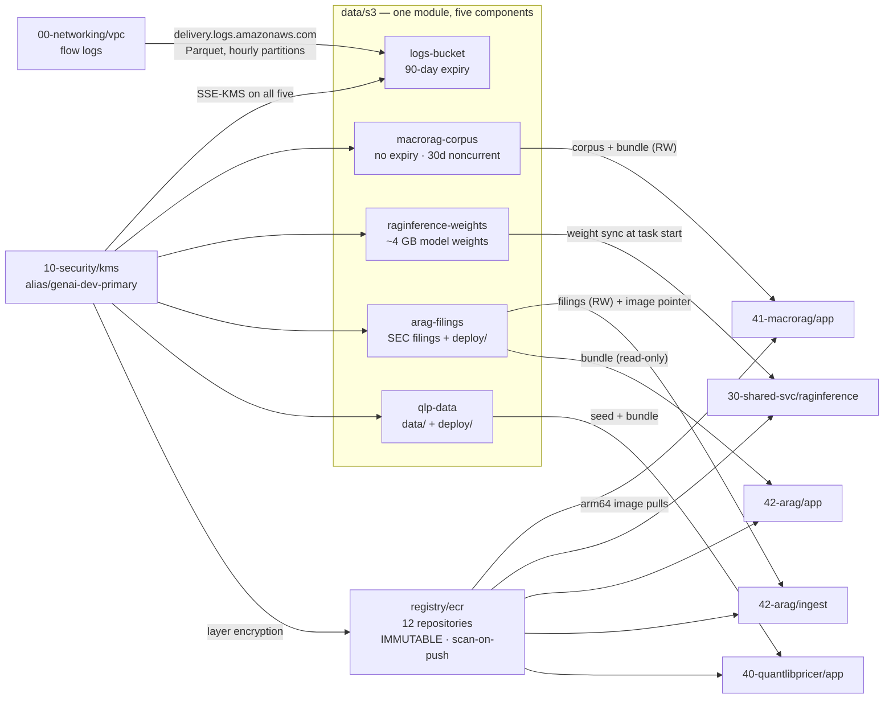

# `20-data` — one bucket module, five buckets, twelve repositories

← [Security](infra-walkthrough-security.md) · up:
[Walkthrough](infrastructure-walkthrough.md) · next:
[Shared services →](infra-walkthrough-shared-services.md)

The data layer is the clearest illustration of a convention in this repo: **security
posture is written once, in a module, and every consumer inherits it.** There is one
S3 module. All five buckets use it. None of them can be public, unencrypted, or
lifecycle-free, because those are not options the module exposes.



---

## 1. `data/s3` — secure by construction

Module: [`data/s3`](../../infra/modules/data/s3/main.tf)

There is no unencrypted, publicly-reachable, or lifecycle-free path through this
module. Callers choose *retention*, not whether to have any.

### What is not configurable

```hcl
resource "aws_s3_bucket_public_access_block" "this" {
  block_public_acls       = true
  block_public_policy     = true
  ignore_public_acls      = true
  restrict_public_buckets = true
}
```

Deliberately **not** a variable. A bucket in this project is never public; an
exception would be a new module, not a flag on this one.

```hcl
resource "aws_s3_bucket_ownership_controls" "this" {
  rule { object_ownership = "BucketOwnerEnforced" }
}
```

`BucketOwnerEnforced` switches ACLs off entirely, so access is governed only by policy
and IAM. This closes the classic "public via object ACL" hole that a public access
block alone does not.

```hcl
rule {
  apply_server_side_encryption_by_default {
    sse_algorithm     = "aws:kms"
    kms_master_key_id = var.kms_key_arn
  }
  bucket_key_enabled = true      # ← the cost lever
}
```

**S3 Bucket Keys cut KMS request charges by up to 99%** by deriving a short-lived
bucket-level key instead of calling KMS per object. No security trade-off; large cost
difference on a write-heavy bucket.

And the lifecycle rule always includes:

```hcl
abort_incomplete_multipart_upload { days_after_initiation = 7 }
```

Orphaned multipart parts are **invisible in the console** and billed as storage
forever. This is one of the quiet ways an S3 bill grows with nothing to show for it.

### The bucket policy

Three statement groups, and one omission that is easy to get wrong.

**TLS enforcement**, on every bucket:

```hcl
statement {
  sid     = "DenyInsecureTransport"
  effect  = "Deny"
  actions = ["s3:*"]
  condition { test = "Bool", variable = "aws:SecureTransport", values = ["false"] }
}
```

Without it, a plain-HTTP request is accepted and the object travels unprotected.

**AWS log delivery** (`allow_aws_log_delivery = true`, only on the logs bucket): two
statements, both required — `s3:GetBucketAcl` on the bucket *and* `s3:PutObject` under
`AWSLogs/<account-id>/*`, each gated on `aws:SourceAccount`. The ACL check is not
optional: the delivery service calls `GetBucketAcl` to confirm it may write, and
without it delivery fails at flow-log creation time.

> **The omission.** Most published examples add an
> `s3:x-amz-acl = bucket-owner-full-control` condition to the write statement. That is
> **wrong for this module**: `BucketOwnerEnforced` disables ACLs, the delivery service
> does not send that header, and the condition would deny every write.

**Encryption-header enforcement** (`restrict_encryption_header`, default true) refuses
an upload that explicitly asks for something other than KMS — but note the second
condition:

```hcl
condition { test = "StringNotEquals", variable = "s3:x-amz-server-side-encryption", values = ["aws:kms"] }
condition { test = "Null",            variable = "s3:x-amz-server-side-encryption", values = ["false"] }
```

The `Null` check scopes the deny to requests that *did* set the header. That is what
keeps ordinary headerless uploads working — they get the bucket's default encryption,
which is already SSE-KMS. The stricter "deny any upload lacking the header" form would
break every normal client.

### Two accepted gaps, stated rather than hidden

- **No event notifications** (`CKV2_AWS_62`). Notifications are a workflow trigger, not
  a security control; enabling them with no consumer creates a target that costs money
  and does nothing. Attach at the call site if needed.
- **No cross-region replication** (`CKV_AWS_144`). This is a real DR control,
  deliberately not taken — CRR roughly doubles storage cost and adds cross-region
  transfer, unjustified for dev. It is recorded as a **known gap**: the module does not
  implement replication *at all*, so a prod bucket that genuinely needs DR requires
  extending it.

---

## 2. The five buckets, and why their lifecycles differ

Naming: `genai-<env>-<purpose>-<region>`. The `genai-` prefix is **mandatory** —
the exec role's S3 grant is ARN-scoped to `arn:aws:s3:::genai-*`, so a bucket named
outside it fails `CreateBucket` with `AccessDenied`. That is the scoping working, not
a bug. The region suffix is for S3's global-namespace uniqueness (bucket names are
unique across *all* AWS accounts), not for routing.

| Bucket | Live-object expiry | Noncurrent cleanup | Transitions |
|---|---|---|---|
| `genai-dev-logs-us-east-1` | **90 days** | 7 days | none |
| `genai-dev-macrorag-corpus-us-east-1` | none | 30 days | none |
| `genai-dev-raginference-weights-us-east-1` | none | 7 days | none |
| `genai-dev-arag-filings-us-east-1` | none | 30 days | none |
| `genai-dev-qlp-data-us-east-1` | none | 30 days | none |

The provisioning principles require a **written reason** whenever `expiration_days = 0`
— "lifecycle everything that accumulates" is a rule, so an exemption must be argued.
Each component makes its case, and they are genuinely different arguments:

- **weights** — read on *every* cold start (scale-from-zero). Expiring them would empty
  the bucket and break the service.
- **corpus** — the durable artefact: raw and processed documents plus the
  `manifest.json` that stamps the index's `world_view_id`. Expiring live objects would
  delete the corpus *and its provenance*.
- **filings** — the source of record for the whole XBRL pipeline. Facts in RDS and
  vectors in Qdrant are *derived* and can be rebuilt; the filings themselves can only
  be re-downloaded from EDGAR.
- **qlp-data** — the reproducibility spine: run manifests, snapshot-addressed market
  data, golden baselines and sign-off records, whose whole value is that a past run can
  still be reconstructed. Its `deploy/` prefix is load-bearing for a different reason —
  expire it and a rebooted host **cannot start its stack at all**.

Growth in all four is bounded by noncurrent-version cleanup instead. Versioning stays
on (the module default) as an accidental-overwrite guard during a re-ingest or re-seed;
superseded copies are cleaned after 7 or 30 days so old copies do not accrue cost
silently.

### Why no storage-class transitions anywhere

This is the counter-intuitive one: IA and Glacier would cost **more** here, not less.

- The corpus, filings and weights are read *repeatedly* — every index build, every
  re-chunk, every cold start. `STANDARD_IA` and `GLACIER` add a per-GB retrieval charge
  on each read plus a 30/90-day storage minimum.
- `qlp-data` has a second, sharper reason: the BFF's DuckDB layer re-globs the parquet
  store on every read (so the objects are hot), and IA bills a **128 KB minimum per
  object** against a store of ~940 tiny parquet files.
- The logs bucket only lives 90 days, so a transition would save pennies and add a
  moving part.

A transition here would be a cost regression dressed as an optimisation.

### `force_destroy = false` everywhere

The module default, and left alone deliberately: a `destroy` must **fail** on a
non-empty bucket. The corpus and filings are not casually disposable, and losing
`qlp-data/deploy/` bricks the app tier's boot path.

### Prefix conventions

Two buckets carry two logically distinct things, separated by prefix rather than by
having two buckets:

```
genai-dev-arag-filings-us-east-1/
  {ticker}/{year}/{form}/...   ← the FilingStore layout XbrlRag's code uses
  deploy/                      ← docker-compose.aws.yml + deploy.env (image tags)
  deploy/ingest.env            ← the ingest runner's image POINTER object

genai-dev-qlp-data-us-east-1/
  data/                        ← seed + backup of the on-disk data tree
  deploy/                      ← compose bundle + deploy.env
```

That is why XbrlRag's *stateless* app tier still needs S3 access at all — it takes a
**read-only** grant on the filings bucket purely to fetch its deploy bundle
(`bundle_read_bucket_arn`), while the ingest runner takes read+write.

> **One bounded over-grant, recorded rather than done silently.** The `ec2-app` module
> scopes S3 by *bucket*, not by prefix, so Faultline's read+write grant on
> `qlp-data` also covers `deploy/` — the host can overwrite the very bundle it boots
> from. Accepted because the alternative is a second bucket for one small object set,
> and a host that can already *read* its bundle and holds the instance role is inside
> the same trust boundary either way. Prefix-scoped grants would be a module
> enhancement.

### Verifying a bucket

```powershell
$env:AWS_PROFILE = "genai-tf"
$b = "genai-dev-arag-filings-us-east-1"

aws s3api get-public-access-block --bucket $b --region us-east-1
aws s3api get-bucket-encryption   --bucket $b --region us-east-1   # expect aws:kms + BucketKeyEnabled
aws s3api get-bucket-versioning   --bucket $b --region us-east-1
aws s3api get-bucket-lifecycle-configuration --bucket $b --region us-east-1
aws s3api get-bucket-policy --bucket $b --region us-east-1 --query Policy --output text | ConvertFrom-Json | ConvertTo-Json -Depth 8
```

The integration tests go further and include the **negative** assertions that matter:
a plain-HTTP request is refused, and one application's role cannot read another
application's bucket.

---

## 3. `ecr` — twelve repositories, one module

Module: [`registry/ecr`](../../infra/modules/registry/ecr/main.tf) ·
Component: [`dev/20-data/ecr`](../../infra/environments/dev/20-data/ecr/terragrunt.hcl)

The component is a single list. Adding a repository is one line.

| Repository | Contents |
|---|---|
| `genai-dev/macrorag`, `…-ui` | MacroRAG API + nginx UI |
| `genai-dev/redis`, `genai-dev/otel-collector` | MacroRAG's compose sidecars, **mirrored** from upstream |
| `genai-dev/qdrant` | the upstream `qdrant/qdrant` arm64 image, **mirrored** |
| `genai-dev/raginference` | the slim ARM64 inference image |
| `genai-dev/arag`, `…-ui`, `…-ingest` | torch-free serving image (api + mcp), nginx UI, full ingest image (Arelle + JRE + boto3) |
| `genai-dev/qlp-backend`, `…-bff`, `…-ui` | QuantLib backend (one image, many entrypoints), QuantLib-free BFF, nginx SPA |

### Why upstream images are mirrored rather than pulled

Three reasons, all practical:

1. **The pull rides the free S3 gateway endpoint.** ECR layers live in S3, so a
   mirrored image is fetched without touching the NAT — no NAT dependency at boot, and
   no per-GB egress charge.
2. **No Docker Hub rate limit** at 11:00 when several hosts start at once.
3. **The exact image is pinned in-account** by tag or digest, so what runs is a
   recorded fact rather than whatever the upstream tag points at today.

### `IMMUTABLE` tags, and what that forces

```hcl
image_tag_mutability = "IMMUTABLE"
scan_on_push         = true
encryption_configuration { encryption_type = "KMS", kms_key = var.kms_key_arn }
```

A pushed tag can never be repointed at different content, so **a deployed tag is a
reliable record of what is running**. The price is that `:latest` is impossible — every
build needs its own tag, and the convention is the git SHA (`arm64-<sha>`,
`slim-arm64-<sha>`).

KMS rather than the AES256 default, so image layers fall under the same key policy and
rotation as everything else. ECR is in the CMK's `kms:ViaService` list, so no
key-policy change was needed.

### The lifecycle policy is not optional

An image repository is the classic silent cost leak: every build adds layers, nothing
removes them, and the growth is invisible until it appears on a bill. Two rules,
evaluated in priority order:

1. Expire **untagged** images after 3 days — they are the residue of overwritten or
   failed pushes and nothing references them.
2. Retain only the **5 most recent** images.

Rule 2 uses `tagStatus = "any"` with `imageCountMoreThan` rather than
`tagStatus = "tagged"`, because `"tagged"` requires an explicit prefix list and would
silently skip images whose tags do not match it.

Creating a repository does **not** push an image. These are empty until a build lands,
and an empty repository costs $0.

### Pushing an image

```powershell
$env:AWS_PROFILE = "genai-tf"
$REGISTRY = "<acct>.dkr.ecr.us-east-1.amazonaws.com"
$TAG = "arm64-$(git rev-parse --short HEAD)"     # commit FIRST, so the tag records what runs

# The login token expires after 12 hours — a 403 on a blob HEAD mid-push means re-login
aws ecr get-login-password --region us-east-1 | docker login --username AWS --password-stdin $REGISTRY

# arm64 is a hard requirement: a mismatched image fails at container start with
# "exec format error", which reads like a corrupt image rather than an arch mismatch
docker buildx build --platform linux/arm64 --push -f infra/docker/Dockerfile `
  -t "$REGISTRY/genai-dev/arag:$TAG" .

# CONFIRM the tag exists before publishing any pointer at it
aws ecr describe-images --repository-name genai-dev/arag `
  --query "imageDetails[?contains(imageTags,'$TAG')].imageTags" --region us-east-1
```

Repositories are immutable, but **adding a new tag to an existing image is allowed** —
which is the cheap repair when a tag prefix was missed on one of several images:

```powershell
docker buildx imagetools create --tag "$REGISTRY/genai-dev/arag-ui:arm64-<sha>" `
                                       "$REGISTRY/genai-dev/arag-ui:<sha>"
```

### Two deferred items, honestly labelled

`scan_on_push` **reports** findings but is not yet a deploy gate, and the immutable-tag
policy needs the SHA-based tagging convention enforced mechanically rather than by
discipline. Both are deferred to pipeline work and recorded as such — see the root
[`README.md`](../../README.md) outstanding-work table.

---

## 4. Where the relational store is

There is no RDS component in `20-data`, even though the numbering suggests there might
be. The single PostgreSQL instance belongs to XbrlRag and lives at `42-arag/db`, alongside
the tier that owns it — MacroRAG deliberately stays on SQLite-on-EBS rather than
introducing a second database. The module is
[`data/rds`](../../infra/modules/data/rds/README.md); it is covered in
[Application tiers](infra-walkthrough-app-tiers.md#3-42-arag--the-only-tier-with-a-database).

---

← [Security](infra-walkthrough-security.md) ·
[Shared services →](infra-walkthrough-shared-services.md)
