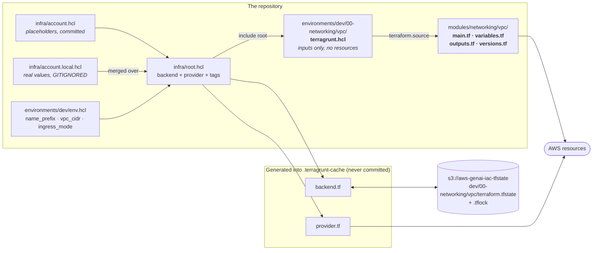
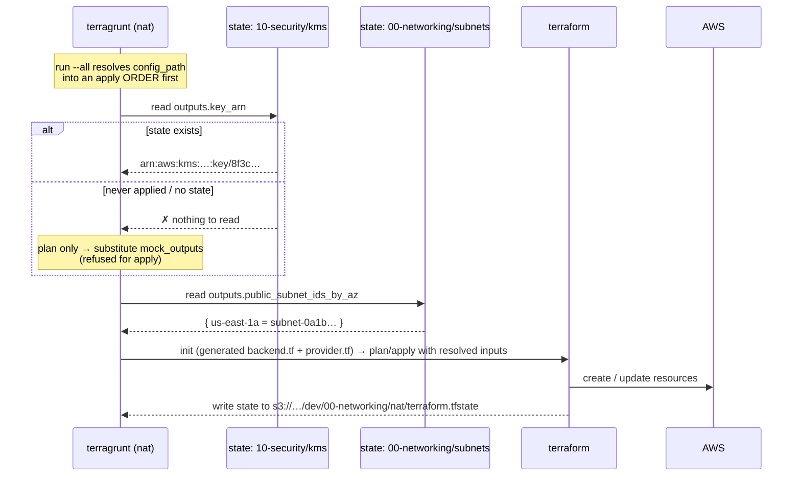
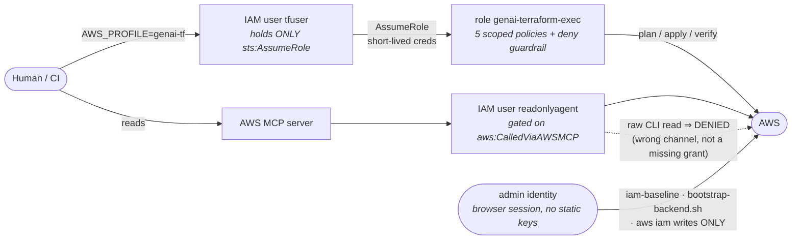

# Foundations — how the IaC itself is put together

← [Infrastructure walkthrough](infrastructure-walkthrough.md) · next:
[Networking →](infra-walkthrough-networking.md)

Before any AWS resource, there is the machinery that decides *where state lives*,
*what order things apply in*, *who is allowed to apply them*, and *what tags every
resource carries*. This layer has no AWS cost and produces no infrastructure of its
own, but almost every confusing failure in the estate traces back to something on
this page.

---

## 1. Terraform and Terragrunt do different jobs

Terraform's own answer to "how do I keep 30 components DRY?" is not great: you
either copy backend configuration into every folder, or you build one enormous root
module whose state file contains the whole estate. Terragrunt is a thin wrapper that
solves exactly that, and this repo uses it for precisely three things:

1. **Generating the backend configuration** for every component, from one place.
2. **Generating the AWS provider block** for every component, so tags and region
   cannot be forgotten.
3. **Wiring components together** — passing one component's outputs into another's
   inputs, and applying them in dependency order.

The split is a hard rule in this repo:

| | Lives in | Contains | May contain a `resource` block? |
|---|---|---|---|
| **Module** | `infra/modules/<area>/<name>/` | `main.tf` `variables.tf` `outputs.tf` `versions.tf` `README.md` | **Yes — only here** |
| **Component** | `infra/environments/<env>/<layer>/<name>/` | one `terragrunt.hcl` (+ optional `*.hcl` locals) | **No** |

A component is composition and documentation. Read one and you get the decision,
the cost, the prerequisites, and the inputs — but no logic.



Every module ships a `versions.tf` pinning the toolchain, e.g.:

```hcl
terraform {
  required_version = ">= 1.8"
  required_providers {
    aws = { source = "hashicorp/aws", version = ">= 5.50" }
  }
}
```

and every component directory carries a committed `.terraform.lock.hcl`, so the
exact provider build is reproducible rather than "whatever was current".

---

## 2. `root.hcl` — the one file every component includes

[`../../infra/root.hcl`](../../infra/root.hcl) is the root Terragrunt
configuration. Every component starts with:

```hcl
include "root" {
  path = find_in_parent_folders("root.hcl")
}
```

**The filename matters.** A root file named `terragrunt.hcl` is a deprecated
Terragrunt anti-pattern — it collides with the component configs of the same name
and errors in a future release — so this one is `root.hcl`, and the bare no-argument
`find_in_parent_folders()` form does **not** work here. It must be given the name.

`root.hcl` does four things.

### 2a. It derives the remote-state key from the folder path

```hcl
state_key = "${replace(path_relative_to_include(), "\\", "/")}/terraform.tfstate"
```

One S3 bucket (`aws-genai-iac-tfstate`), one key per component, and the key *is*
the folder path — so `infra/environments/dev/00-networking/vpc` stores its state at
`dev/00-networking/vpc/terraform.tfstate`. There is no registry of state keys to
maintain and no chance of two components sharing one.

The `replace(..., "\\", "/")` is not cosmetic. On Windows,
`path_relative_to_include()` returns backslashes, and S3 keeps a backslash as a
literal key character. A POSIX shell or a CI runner would then compute a
*different* key, find no state, and try to recreate the entire environment.
Normalising to forward slashes is what makes the same state readable from Windows
and Linux.

### 2b. It configures locking without DynamoDB

```hcl
remote_state {
  backend = "s3"
  config = {
    bucket       = local.account.state_bucket
    key          = local.state_key
    encrypt      = true
    use_lockfile = true      # S3-native conditional-write lock
  }
}
```

The classic Terraform pattern is an S3 bucket plus a DynamoDB table for locking.
`dynamodb_table` is now deprecated in the S3 backend; `use_lockfile = true` uses an
S3 conditional write on a sibling `<key>.tflock` object instead. That removes a
table, its IAM grants, and its cost — and the exec role needs no new permissions,
because its existing `s3:PutObject`/`DeleteObject` on the state bucket already
covers the lock object.

### 2c. It generates a provider with mandatory tags

```hcl
generate "provider" {
  path     = "provider.tf"
  contents = <<EOF
provider "aws" {
  region              = "${local.account.region}"
  allowed_account_ids = ["${local.account.account_id}"]
  default_tags {
    tags = {
      Project     = "aws-genai-iac"
      Environment = "${local.env.name}"
      ManagedBy   = "terragrunt"
    }
  }
}
EOF
}
```

Two safety properties fall out of this. `default_tags` means **every** resource
gets `Project` / `Environment` / `ManagedBy` without any module remembering to add
them — which matters because real IAM policies in this estate condition on
`aws:ResourceTag/Project` (the app permissions boundary only allows stopping
instances tagged `Project=aws-genai-iac`). And `allowed_account_ids` makes an apply
against the wrong account fail immediately rather than provisioning a shadow estate
somewhere else.

`provider.tf` and `backend.tf` are **generated**, not committed. You will see them
appear inside `.terragrunt-cache/`; never edit them.

### 2d. It merges committed config with a gitignored override

```hcl
account_base       = read_terragrunt_config(find_in_parent_folders("account.hcl")).locals
account_local_path = find_in_parent_folders("account.local.hcl", "")
account_local      = try(read_terragrunt_config(local.account_local_path).locals, {})
account            = merge(local.account_base, local.account_local)
```

[`../../infra/account.hcl`](../../infra/account.hcl) is committed and holds
**placeholders only** — `account_id = "000000000000"`, the region, the state bucket
name, the $150 monthly budget. The real account id and the personal alert email
addresses live in `infra/account.local.hcl`, which is **gitignored**, and are merged
over the top. This is what lets the whole repository be public-safe: no real account
identifier appears in any committed file, including docs and comments.

> **Why `try` and not a ternary.** The obvious form —
> `path == "" ? {} : read_terragrunt_config(path).locals` — does *not* work. HCL
> type-checks both branches of a conditional, and an empty object is not
> type-consistent with a populated one, so it fails with "Inconsistent conditional
> result types" *even when the file is present*. `try` short-circuits on the read
> error instead of unifying types. This comment is repeated in every component that
> reads the override, because it is genuinely surprising.

### 2e. `env.hcl` — the per-environment knobs

[`../../infra/environments/dev/env.hcl`](../../infra/environments/dev/env.hcl) is
tiny and load-bearing:

```hcl
locals {
  name         = "dev"
  name_prefix  = "genai-dev"
  vpc_cidr     = "10.10.0.0/16"
  ingress_mode = "ssm"        # or "alb"
}
```

`name_prefix` is the **isolation boundary** of this whole design. Because `dev`,
`staging` and `prod` share one AWS account, the prefix is what separates them: IAM
policies are ARN-scoped to `genai-*`, buckets are named `genai-dev-*`, and the exec
role literally cannot create a bucket outside that prefix (`CreateBucket` returns
`AccessDenied` — that is the scoping working, not a bug).

`ingress_mode` is a single line of version-controlled config that governs whether
*any* application in the environment has a public front door. Flipping it and
applying creates or destroys the shared ALB. It is a file edit rather than a console
action precisely so that an environment's ingress state is always visible in git and
auditable.

---

## 3. Dependencies, outputs and `mock_outputs`

A component declares what it needs from another component:

```hcl
dependency "kms" {
  config_path = "../../10-security/kms"

  mock_outputs = {
    key_arn = "arn:aws:kms:us-east-1:000000000000:key/00000000-0000-0000-0000-000000000000"
  }
  mock_outputs_allowed_terraform_commands = ["plan", "validate"]
}

inputs = {
  kms_key_arn = dependency.kms.outputs.key_arn
}
```

Three things are happening.

**The dependency graph is derived from `config_path`.** `terragrunt run --all …`
reads every component's dependencies and applies them in topological order, so
`task apply ENV=dev` will not attempt the NAT before the subnets exist.

**Outputs cross state boundaries.** `dependency.kms.outputs.key_arn` reads the KMS
component's *state* — which is why per-component state is workable at all. No
component hardcodes another's ARN.

**`mock_outputs` makes `plan` work before the dependency exists.** Without it, you
cannot plan a component whose dependency has never been applied (or in CI with no
state at all) — Terragrunt has nothing to read. The mock supplies a
correctly-shaped fake, restricted to `plan` and `validate` so it can never leak
into an `apply`. The mocks in this repo use `000000000000` as the account id for the
same reason `account.hcl` does.



> **A dependency output does not propagate on its own.** If you replace an instance
> and a *different* component holds its id, that component keeps the old value
> until it is re-applied. This has bitten the estate for real: when the NAT
> instance was replaced, `nat-schedule` kept targeting the destroyed instance and
> would have failed silently that night. Two mitigations exist — re-apply the
> dependents (or use `run --all`), and
> [`../../tests/integration/test_schedule_targets.py`](../../tests/integration/test_schedule_targets.py)
> asserts every schedule points at a live instance. The deeper fix, used by the app
> tiers, is to *not have a second component* — see
> [Scheduling](infra-walkthrough-scheduling-observability.md#2-where-a-schedule-must-live).

### The `//` in a module source

Most components point at a module plainly:

```hcl
terraform { source = "${get_repo_root()}/infra/modules/networking/vpc" }
```

But the app tiers use a double slash:

```hcl
terraform { source = "${get_repo_root()}/infra/modules//compute/ec2-app" }
```

Terragrunt copies **only the directory named before the `//`** into its cache.
`compute/ec2-app` calls a sibling module (`../../scheduler/eventbridge`) for its
start/stop schedule, and without the marker that sibling is outside the copied tree,
so `init` fails with `Unable to evaluate directory symlink: ..\..\scheduler`. With
the marker, Terragrunt copies all of `infra/modules` and uses `compute/ec2-app` as
the working directory. It is a *path* change only — resource addresses are
unaffected, so switching an already-applied component to this form plans as **no
changes**.

---

## 4. Who is allowed to apply — three identities, and one that is off-limits

This is the part of the foundations with real security weight.

| Profile | Identity | Used for |
|---|---|---|
| `readonlyagent` | read-only IAM user | reads, **through the AWS MCP server only** |
| `genai-tf` | `tfuser` → assumes `genai-terraform-exec` | all provisioning, ECR pushes, deploy scripts, `task verify` |
| `tfuser` | thin user holding `sts:AssumeRole` and nothing else | the doorway to `genai-tf` |
| `<admin-profile>` | the human's admin (browser session) | `global/iam-baseline`, `aws iam` writes, the one-time backend bootstrap |



**There is deliberately no `[default]` profile.** It was removed from
`~/.aws/config` so that an unpinned AWS call fails with `NoCredentials` instead of
silently running as admin. Pin `AWS_PROFILE` (or `--profile`) every time:

```powershell
$env:AWS_PROFILE = "genai-tf"
aws sts get-caller-identity     # the ONLY reliable way to see which identity a profile resolves to
task whoami                     # same, plus a verdict on whether it is right for plan/apply
```

`$env:` variables are per-shell. A new terminal silently drops them, which is a
recurring source of "it worked five minutes ago".

Three things follow that surprise people:

- **`readonlyagent` cannot use the raw AWS CLI.** Its grants are condition-gated on
  `aws:CalledViaAWSMCP`, so a raw-CLI read fails with *"no identity-based policy
  allows this action"* — which looks like a missing permission but is really the
  wrong channel.
- **`global/iam-baseline` must be applied by an admin**, because the exec role
  cannot create itself and its guardrail denies `iam:*User*`. `task iam-baseline`
  refuses to run if you *are* the exec role.
- **`task plan|apply|verify` refuse to run if you are not the exec role.** Direct
  `terragrunt` calls bypass that guard, which is a reason to prefer the task
  targets for whole-environment operations.

The full identity model is in
[`../runbooks/terraform-execution-role.md`](../runbooks/terraform-execution-role.md);
what the exec role can actually *do* is in
[Security](infra-walkthrough-security.md#3-the-terraform-execution-role).

---

## 5. Bootstrapping from nothing

Order matters, because the state backend cannot store its own state and the exec
role cannot create itself.

```bash
# 1. As an ADMIN: create the S3 state bucket (versioned, SSE-KMS). One time only.
#    Locking is S3-native, so there is no DynamoDB table to create.
bash scripts/bootstrap-backend.sh

# 2. As the SAME ADMIN: apply the IAM baseline. Do NOT set an assume_role provider
#    here — the role being created does not exist yet.
task iam-baseline
#   == cd infra/environments/global/iam-baseline && terragrunt apply

# 3. Create tfuser's access key OUT OF BAND, so the secret never enters state:
aws iam create-access-key --user-name tfuser

# 4. Everything from here as the exec role.
```

```powershell
$env:AWS_PROFILE = "genai-tf"
task whoami                                    # assumed-role/genai-terraform-exec/...
task plan  ENV=dev                             # read it
task apply ENV=dev
task verify
```

Full step-by-step, including the account-level baseline, is
[`../runbooks/provision-env.md`](../runbooks/provision-env.md).

---

## 6. Reading a component: an annotated example

Here is a whole component — [`dev/00-networking/subnets`](../../infra/environments/dev/00-networking/subnets/terragrunt.hcl)
— with everything from this page in it:

```hcl
# Step 4. Public and private tiers across 2 AZs ...          ← ① the decision + cost,
# Cost: $0. Subnets, route tables and associations are free.    stated in the file
# Apply as the exec role: AWS_PROFILE=genai-tf

include "root" {                                            # ② backend + provider
  path = find_in_parent_folders("root.hcl")                  #    + default tags
}

locals {                                                     # ③ read env knobs
  env = read_terragrunt_config(find_in_parent_folders("env.hcl")).locals
}

dependency "vpc" {                                           # ④ ordering + outputs
  config_path = "../vpc"
  mock_outputs = { vpc_id = "vpc-00000000000000000", ... }   #    plan before apply
  mock_outputs_allowed_terraform_commands = ["plan", "validate"]
}

terraform {                                                  # ⑤ which module
  source = "${get_repo_root()}/infra/modules/networking/subnets"
}

inputs = {                                                   # ⑥ wiring only —
  name_prefix         = local.env.name_prefix                #    no resources here
  vpc_id              = dependency.vpc.outputs.vpc_id
  internet_gateway_id = dependency.vpc.outputs.internet_gateway_id
  az_count            = 2
}
```

Note ① in particular. The header comment is where the *why* and the *cost* live for
this specific environment, and it is the first thing to read when you meet a
component. The module README carries the general rationale; the component header
carries this deployment's.

---

## 7. Gates that run before anything reaches AWS

```powershell
task ci        # ruff + ruff format --check + mypy + pytest (unit), and terraform fmt -check
task policy    # checkov over infra/, config in policies/checkov/.checkov.yaml
```

`task policy` runs checkov through `uvx --from checkov==3.2.457` rather than the
project's conda env, because checkov pins `networkx<3` and installing it into the
shared env breaks other projects on the machine. Pinned version, isolated
interpreter.

Checkov findings in this repo are either **fixed** or **skipped with a written
reason at the exact resource**, never suppressed globally. The skips are worth
reading — they are the clearest examples of where a generic policy engine and a
specific design disagree:

- A **KMS key policy** must use `Resource: "*"` (naming the key's own ARN is
  self-referential and cannot be resolved without a cycle) and must delegate to the
  account root (AWS's documented anti-lockout requirement). Both trip checkov;
  omitting either breaks the key.
- A **VPC endpoint policy** is an intersection *filter*, not a grant — it can only
  subtract permissions. Checkov scores it as though it were attached to a role,
  which inverts the reading of the `s3:GetObject` on `*` statement.
- A **permissions boundary** defines the *ceiling* of privilege, not an
  entitlement. A boundary narrow enough to satisfy the checks would break every
  role it exists to cap.

Where a skip stands in for a control checkov cannot see, the compensating control is
a test. `test_exec_role_containment.py`, for instance, uses AWS's own
`iam:SimulatePrincipalPolicy` to prove that twelve escalation actions are
`explicitDeny` and that role creation is refused without the project boundary —
evidence a static scanner structurally cannot produce.

Terraform-side checks (`fmt`, `validate`, `tflint`) run through pre-commit; see
[`../../.pre-commit-config.yaml`](../../.pre-commit-config.yaml).

---

## Onward

- [Networking →](infra-walkthrough-networking.md) — the first real AWS resources
- [Security](infra-walkthrough-security.md) — what the exec role can do, and the
  boundary that caps everything it creates
- [Scheduling, observability, cost](infra-walkthrough-scheduling-observability.md) —
  where the "a second component holds a copy of the id" failure gets solved
