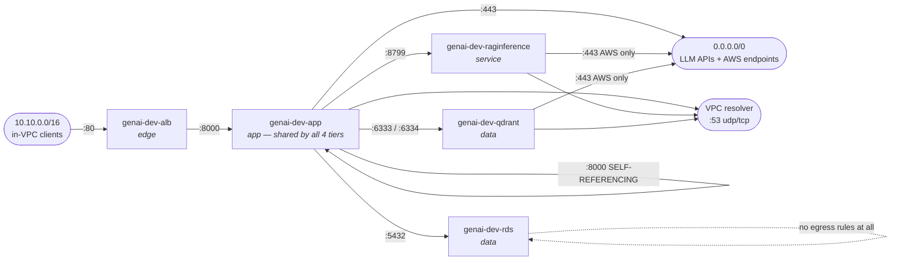
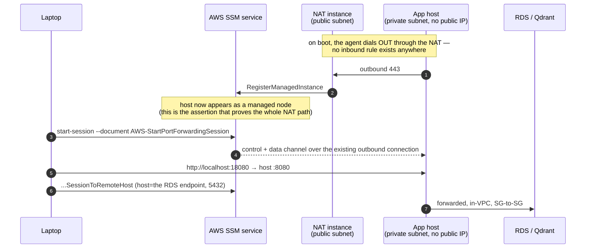

# `00-networking` — the network, and why nothing is reachable

← [Foundations](infra-walkthrough-foundations.md) · up:
[Walkthrough](infrastructure-walkthrough.md) · next:
[Security →](infra-walkthrough-security.md)

Seven components, applied in this order:

```
vpc → subnets → nat → endpoints → security-groups → nat-schedule
                                                     dns
```

They are separate deliberately. The VPC component creates no subnets; the subnets
component creates no NAT route; the NAT arrives on its own and its schedule arrives
after that. Each is a `plan` you can read in full, and each has a verification step
that either passes or does not.

---

## 1. `vpc` — the container, plus three things people forget

Module: [`networking/vpc`](../../infra/modules/networking/vpc/main.tf) ·
Component: [`dev/00-networking/vpc`](../../infra/environments/dev/00-networking/vpc/terragrunt.hcl)

The VPC itself is `10.10.0.0/16` with DNS support and DNS hostnames on — both are
prerequisites for VPC endpoints and private hosted zones, so they are not optional
here despite reading as defaults.

Three other resources are in this component, and each exists for a reason that is
easy to miss.

### The default security group is stripped, not ignored

```hcl
resource "aws_default_security_group" "this" {
  vpc_id = aws_vpc.this.id
  tags   = { Name = "${var.name_prefix}-default-DO-NOT-USE" }
  # NO ingress or egress blocks — this is the point
}
```

AWS creates a default security group with every VPC. It carries an
allow-all-from-self ingress rule and unrestricted egress, **it cannot be deleted**,
and anything launched without an explicit security group lands in it.

Declaring the resource with no `ingress` or `egress` blocks *removes every rule*. The
default becomes deny-all, so a workload that accidentally uses it fails closed and
visibly, rather than silently acquiring broad connectivity. It is managed here rather
than in the later `security-groups` step because AWS creates it the instant the VPC
exists — deferring would leave a window in which it is open.

### The Internet Gateway is not exposure

An IGW is free and grants no reachability by itself. Traffic additionally needs a
route table entry pointing at it, a subnet using that route table, and a permissive
security group. After this component, none of those exist.

### Flow logs go to S3, in Parquet, and can fail silently

```hcl
resource "aws_flow_log" "this" {
  log_destination_type = "s3"
  log_destination      = var.flow_log_destination_arn
  traffic_type         = "ALL"
  max_aggregation_interval = 600

  destination_options {
    file_format                = "parquet"
    per_hour_partition         = true
    hive_compatible_partitions = true
  }
}
```

Three cost choices, all deliberate:

- **S3, not CloudWatch Logs** — $0.25/GB vs $0.50/GB. Logs Insights is not worth
  double the ingest cost at dev volume.
- **Parquet** — ~20% smaller on ingest, and columnar, so Athena scans a fraction of
  the bytes.
- **600-second aggregation** — fewer, larger objects. The cost is coarser timing,
  which only matters while investigating live traffic.

Hourly Hive-compatible partitions mean an Athena query scans one hour's objects
instead of the whole bucket — the difference between cents and dollars per query once
the archive has any size.

There is **no IAM role** here, which surprises people: a flow-log role is required
only for the CloudWatch Logs destination. S3 delivery is authorised entirely by the
destination bucket's policy plus, for SSE-KMS, the key policy — which is why this
component depends on `20-data/logs-bucket` (applied out of numeric order for exactly
this reason) and why the KMS module sets `allow_aws_log_delivery = true`.

> **The failure mode worth internalising.** Miss either grant and AWS reports the
> flow log as `ACTIVE` and delivers **nothing**. No error, anywhere. That is why
> [`test_vpc.py`](../../tests/integration/test_vpc.py) asserts an object has actually
> landed in the bucket, not merely that the flow log exists. First delivery takes
> 5–10 minutes after the VPC sees traffic.

---

## 2. `subnets` — addressing, and one free decision that avoids a migration

Module: [`networking/subnets`](../../infra/modules/networking/subnets/main.tf) ·
Component: [`dev/00-networking/subnets`](../../infra/environments/dev/00-networking/subnets/terragrunt.hcl)

Two AZs, chosen because subnets and route tables cost **nothing** — there is no
reason to start with one, and per-AZ charges only appear with NAT devices, load
balancer nodes, and cross-AZ data transfer.

| Tier | `us-east-1a` | `us-east-1b` |
|---|---|---|
| Public | `10.10.0.0/20` | `10.10.16.0/20` |
| Private | `10.10.128.0/20` | `10.10.144.0/20` |

Public occupies the low indices and private a clearly separated block
(`private_subnet_offset = 8`), so the tier is obvious from the CIDR alone when you
are reading a route table at 2 a.m. Roughly 4,000 usable addresses per subnet, with
most of the `/16` left unallocated.

### `map_public_ip_on_launch = false` — even on the public subnets

Auto-assignment means a workload becomes internet-addressable purely by landing in a
subnet, with no explicit decision recorded anywhere in code. Anything that genuinely
needs a public address requests one at launch, which shows up in a plan and in
review. (The NAT instance is the only thing in the estate that does.)

### One private route table *per AZ*, not one shared

Route tables are free. Per-AZ tables let a future egress device be reached without
crossing an AZ boundary — which would otherwise incur $0.01/GB **in each direction**.
It costs nothing now and avoids a migration later. The module exports
`private_route_table_ids_by_az` precisely so a NAT device can be placed in the same
zone as the subnets routing to it.

Every subnet is associated with a route table **by name**. Nothing falls through to
the VPC's main route table, so a subnet created outside IaC fails closed rather than
inheriting connectivity.

After this component, private subnets can reach only the VPC-local range. There is
no egress path at all, which makes the public/private split real and testable *now*
rather than asserted.

---

## 3. `nat` — a `t4g.nano` instead of a NAT Gateway

Module: [`networking/nat-instance`](../../infra/modules/networking/nat-instance/main.tf) ·
Component: [`dev/00-networking/nat`](../../infra/environments/dev/00-networking/nat/terragrunt.hcl) ·
Rationale: [design §2a](../design/aws-service-consolidation.md)

This is the estate's most consequential cost decision, and it was a *revision*: the
original design said NAT Gateway.

**A NAT Gateway cannot be paused.** It bills $0.045/hour for every hour it *exists*,
regardless of traffic — there is no stop state. The only way to suspend the charge is
to delete and recreate it, which means new gateway IDs and route-table rewrites every
cycle. Set against a dev estate that deliberately stops its app instances off-hours
(~36% uptime), the NAT Gateway would have become **the single largest line item in
dev** — larger than all the application compute it exists to serve.

| | 24/7 | Scheduled (~36%) |
|---|---|---|
| NAT Gateway | $32.85/mo | $32.85/mo (unpausable) |
| `t4g.nano` NAT instance | $7.31/mo | **~$3–4/mo** |

An EC2 instance genuinely stops. The accepted costs are stated plainly: we own
patching, and it is a single point of failure with no health check and no automatic
replacement. Both are fine for dev; **prod keeps the NAT Gateway**.

### The three lines that make it work

```hcl
source_dest_check = false                                    # ①
user_data         = file("${path.module}/user-data.sh")       # ② systemd, not one-shot
network_interface_id = aws_instance.nat.primary_network_interface_id   # ③ route target
```

**① `source_dest_check = false`** is *the* line that turns an instance into a NAT.
With the check on, EC2 drops any packet whose source or destination is not the
instance itself — which is every forwarded packet. The symptom if you miss it:
private instances have a perfectly correct route and still cannot reach anything.

**② NAT rules are applied by a systemd unit, not by cloud-init.** `cloud-init` runs
on **first boot only**. This instance is *designed* to be stopped and started daily,
so one-shot `iptables` commands would vanish on the second start — presenting as "the
internet stopped working" on a healthy-looking instance. The unit reapplies on every
boot, idempotently, so repeated starts do not stack duplicate rules.

**③ Routes target the ENI, not the instance id.** The ENI survives a stop/start, so
the `0.0.0.0/0` route in each private table stays valid across the nightly shutdown.
Traffic blackholes while the instance is down and resumes when it returns — no route
churn, no automation to restore egress. This is precisely what a NAT Gateway cannot
do.

### Security posture on a public-subnet box

`checkov`'s CKV_AWS_88 ("EC2 instance should not have public IP") is the one check
this module exists to violate — a NAT device sits in a public subnet with a public
address *by definition*, and that address is what private traffic is translated to.
The compensating controls are the ones that matter for a public-facing host:

- **Ingress is wide by protocol but narrow by source.** All protocols (`-1`) from the
  two private subnet CIDRs and **never** from the internet. A NAT forwards whatever
  the private tier sends, so restricting protocols would break anything not
  anticipated; the *source* is the control.
- **No SSH rule and no key pair** — anywhere in this repository. The instance role
  exists solely to let the SSM agent register, on a box whose actual job needs no AWS
  permissions at all.
- **IMDSv2 required**, hop limit 1. IMDSv1's unauthenticated GET is the classic SSRF
  path to instance credentials; requiring a token makes it a two-step exchange a
  simple request forgery cannot complete.
- **Root volume encrypted** with the project CMK.
- **Kernel hardening** in `user-data.sh`: ICMP redirects neither accepted nor sent,
  since on a forwarding host they can reroute traffic through an attacker-chosen next
  hop.

An **auto-assigned public IP, not an Elastic IP**: an EIP costs the same $0.005/h
while running *and* keeps billing while stopped. The address changes on restart,
which is irrelevant for outbound-only NAT since nothing allowlists our egress
address.

`ignore_changes = [ami]` stops a newer AL2023 release silently replacing the instance
on an unrelated plan — which would drop every private-tier connection mid-apply.
Patching happens in place via SSM; an AMI refresh is a deliberate taint-and-replace.

### Two operational facts

**Expect a ~16-minute first apply.** `aws_instance.nat` took 15m52s on first
creation. That is not a hang: the IAM role and instance profile are created in the
same apply, IAM is eventually consistent, and `RunInstances` rejects a just-created
instance profile until it has propagated, so the provider retries. Subsequent applies
finish in under a minute.

**Verifying it actually forwards is not obvious.** Every attribute can be correct
while it forwards nothing — on first build, `configure-nat.service` failed because
**AL2023 does not ship `iptables`** (it usually arrives as a Docker dependency, so it
is easy to assume present). Neither of the tempting checks proves anything: the NAT's
*own* SSM registration works because it sits in a public subnet and reaches SSM
straight out the IGW, and flow logs delivering proves only that VPC infrastructure is
emitting them.

> **The real proof is a *private* instance registering as an SSM managed node.** A
> private-subnet host can only reach the SSM endpoints through this NAT, so that
> single assertion exercises routes, `source_dest_check`, masquerading and the
> security group at once. It lives in
> [`test_macrorag_instance.py`](../../tests/integration/test_macrorag_instance.py),
> not in the NAT's own tests, because it needs a private-subnet instance to exist.

```powershell
# The assertion that matters, by hand
aws ec2 describe-instances --instance-ids <nat-id> `
  --query "Reservations[].Instances[].SourceDestCheck" --region us-east-1
aws ssm describe-instance-information `
  --filters "Key=InstanceIds,Values=<a-PRIVATE-instance-id>" `
  --query "InstanceInformationList[].PingStatus" --region us-east-1
```

---

## 4. `endpoints` — the free thing that does more than save money

Module: [`networking/endpoints`](../../infra/modules/networking/endpoints/main.tf) ·
Component: [`dev/00-networking/endpoints`](../../infra/environments/dev/00-networking/endpoints/terragrunt.hcl)

One S3 **gateway** endpoint. Gateway endpoints work by injecting a prefix-list route
into the route tables you list: no ENI, no hourly charge, no data-processing charge —
**$0.00/month**. Contrast **interface** endpoints at ~$7.30/month per AZ each, which
is why three of them (ECR/Secrets/Logs) are deliberately *not* used in dev: ~$22/month
to avoid NAT data charges amounting to pennies. Break-even is roughly 162 GB/month
per service.

The payoff is bigger than it sounds, because **ECR image layers are stored in S3**.
Container pulls are usually the largest S3-shaped traffic a workload generates, and
routing them through this endpoint removes the bulk of it from the NAT path — where
per-GB charges would otherwise accumulate. The same applies to the deploy-bundle
`s3 sync` every app host performs on boot, and to RagInference's ~4 GB weight sync.

### The endpoint policy splits on WRITE vs READ, not on ownership

The obvious design — "restrict the endpoint to our own buckets" — breaks things
badly. ECR layer buckets, Amazon Linux repositories and SSM agent downloads all live
in **AWS-owned** S3 buckets whose names vary by region and change over time. Denying
them produces opaque S3 403s during instance bootstrap that read as networking
faults.

| Target | Access through the endpoint |
|---|---|
| `arn:aws:s3:::genai-*` and the state bucket | Full (`s3:*`) |
| Everything else | **Read-only** (`GetObject`, `GetObjectVersion`, `ListBucket`, `GetBucketLocation`) |

Exfiltration through an S3 endpoint means `PutObject` to a bucket someone else
controls. Reading foreign buckets is not the risk, and is load-bearing. So this
closes the write-out path without an allow-list of AWS bucket names that would break
the first time AWS renamed one. It is defence in depth, not the primary control — the
app permissions boundary already scopes `s3` to `genai-*` — and it matters because it
applies to *anything* in the VPC, including a compromised process holding credentials
IAM would otherwise permit.

### Route-table coverage is a correctness issue

The component passes `all_route_table_ids` — public **and** private. A route table
left out keeps sending S3 traffic the long way, through NAT at $0.045/GB, **with no
error anywhere**. The test asserts every route table in the VPC carries the endpoint
route.

---

## 5. `security-groups` — five tiers, wired by reference

Module: [`networking/security-groups`](../../infra/modules/networking/security-groups/main.tf) ·
Component: [`dev/00-networking/security-groups`](../../infra/environments/dev/00-networking/security-groups/terragrunt.hcl)

All five groups live in one component so that tiers can reference each other by group
id rather than each application inventing its own rules.



Every arrow above is a **group reference**, not a CIDR, except the three that
genuinely need an address range (`:80` from the VPC, `:443` outbound, and DNS).

| Group | Admits | Egresses to |
|---|---|---|
| `genai-dev-alb` | HTTP/80 from the VPC CIDR | the `app` group on 8000 |
| `genai-dev-app` | the `alb` group on 8000; **itself** on 8000 | 443 anywhere (LLM APIs), DNS to the VPC resolver, `raginference`, `qdrant`, `rds`, and itself |
| `genai-dev-raginference` | the `app` group on 8799 | 443 to AWS endpoints, DNS. **No external LLM traffic** — it *is* the model server |
| `genai-dev-qdrant` | the `app` group on 6333/6334 | 443 to AWS endpoints, DNS |
| `genai-dev-rds` | the `app` group on 5432 | **nothing** — RDS initiates no egress |

### Rules are separate resources, never inline blocks

```hcl
resource "aws_vpc_security_group_ingress_rule" "app_from_alb" { ... }
```

Inline `ingress`/`egress` blocks are *authoritative for the whole group*: a rule
added later by another module silently deletes the others. Separate
`aws_vpc_security_group_*_rule` resources compose, and each appears individually in a
plan — so you can see exactly which rule is being added.

### Group references, not CIDRs

Every east-west rule names another security group as its counterparty. Instances come
and go — Fargate task IPs churn, the Qdrant host is stopped and started nightly, and
any `user_data` change replaces an app host — so a CIDR rule would be either too
broad or in need of editing every time. `referenced_security_group_id` stays correct
through all of it.

### The two rules worth understanding

**`app_https` egresses to `0.0.0.0/0` on 443.** Unavoidable: the workloads call
`api.openai.com` and `api.anthropic.com`, which publish no stable address range. It
is restricted to port 443 rather than all ports, and the tier sits in a private
subnet.

**`app_from_app` / `app_to_app` are self-referencing, and are a stated relaxation.**
Faultline's `scenariogen` calls XbrlRag and MacroRAG over REST, both of which serve
on `app_port` (8000). Nothing else covers that: `app_from_alb` admits the ALB alone,
so two hosts in the same group cannot reach each other in either direction, and in
dev the ALB is torn down so routing east-west through it is not an option. A
self-referencing rule — the group naming itself as counterparty — is what lets members
talk to each other, and it survives instances being stopped, started and replaced.

The relaxation is that because the estate shares **one** app-tier group, this admits
*any* app host to *any* other on 8000, not just Faultline to its two
dependencies. MacroRAG gains a path to XbrlRag's API it has no reason to use. Bounding
controls: exactly one TCP port (not a range, not all protocols), private subnets
only, no CIDR, and the tier is already a single trust domain in dev where these
services run without auth by explicit decision — the network *is* the boundary. The
least-privilege answer is a group per application, which is a prod-hardening change
because it would reprovision every existing host.

Note also both directions are declared. Security groups are stateful *for a given
rule*, but the caller needs egress and the callee needs ingress — and here they are
the same group wearing both hats.

### Why DNS needs an explicit egress rule

```hcl
resource "aws_vpc_security_group_egress_rule" "app_dns_udp" {
  cidr_ipv4   = var.vpc_cidr     # the Amazon-provided resolver, scoped to the VPC
  ip_protocol = "udp"
  from_port   = 53
}
```

Egress rules apply to outbound traffic even for the VPC resolver. Omit these and name
resolution breaks in a way that looks like a network fault. TCP/53 is there too, for
responses over 512 bytes.

### The `alb` group exists even though the ALB does not

Security groups cost nothing, and the app tier's ingress rule references the ALB
group by id — destroying it would break that reference. So only *billable* resources
are gated by the ingress switch. This is why several groups carry a time-bounded
`checkov:skip=CKV2_AWS_5` ("security group is unused"): they were defined one step
ahead of their consumers. That skip is a promise, not a dismissal — if it is still
there once the consumer exists, the group is genuinely orphaned.

---

## 6. `dns` — Cloud Map, not an internal ALB

Module: [`networking/dns`](../../infra/modules/networking/dns/main.tf) ·
Component: [`dev/00-networking/dns`](../../infra/environments/dev/00-networking/dns/terragrunt.hcl)

One resource: a Cloud Map private DNS namespace, `genai-dev.internal`, which creates
a Route 53 private hosted zone scoped to the VPC. ~$0.50/month for the zone; queries
are pennies.

Backend services register a Cloud Map service in it and become reachable at
`<service>.<namespace>:<port>` from any in-VPC client, with **no load balancer and no
public exposure**:

| Name | Port | Registered by |
|---|---|---|
| `qdrant.genai-dev.internal` | 6333 (REST, TLS) / 6334 (gRPC) | [`data/qdrant`](../../infra/modules/data/qdrant/main.tf) |
| `raginference.genai-dev.internal` | 8799 | [`compute/ecs-service`](../../infra/modules/compute/ecs-service/main.tf) |
| `macrorag.genai-dev.internal` | 8000 | [`compute/ec2-app`](../../infra/modules/compute/ec2-app/main.tf) |
| `arag.genai-dev.internal` | 8000 | same |

Chosen over an internal ALB for pure backend traffic because it needs no listener,
carries no hourly charge, and is **unaffected by the `ingress_mode` toggle** — that
switch governs user-facing reach, not east-west service calls. An ALB-fronted ECS
service also hits a chicken-and-egg: ECS refuses to create a service whose target
group is not already associated with a load balancer.

**Registration lives in the module that owns the resource**, never in a separate
component. The A record's value *references* `aws_instance.app.private_ip` in the same
state, so Terraform rewrites it during the same apply that replaces the instance —
there is no window where the name points at a dead host, and no second component to
remember to re-apply. The TTL is 10 seconds so any brief window clears fast. Two
properties make this safe: a VPC instance keeps its private address across
stop/start, so a scheduled tier does not churn its record daily. The residual risk is
an instance changed *outside* Terraform, which
[`test_app_discovery.py`](../../tests/integration/test_app_discovery.py) catches —
because the runtime symptom will not: a stale A record still resolves, and the caller
times out as though the remote application were broken.

---

## 7. So how does anyone actually reach anything?

There is no bastion, no SSH, no key pair, and — with `ingress_mode = "ssm"` — no load
balancer. Every workload is in a private subnet with no public IP. Access is **SSM
Session Manager**, whose agent dials *outbound*, so it needs no inbound rule at all.



If the NAT is stopped, step 1 never happens: the host is healthy and **completely
unreachable**, which is why the NAT window brackets every other window.

```powershell
# Never hardcode an instance id — any user_data change replaces the host.
$id = aws ec2 describe-instances `
  --filters "Name=tag:Name,Values=genai-dev-arag" "Name=instance-state-name,Values=running" `
  --query "Reservations[].Instances[].InstanceId" --output text --region us-east-1

# An interactive shell on the host
aws ssm start-session --target $id --region us-east-1 --profile <ssm-profile>

# Forward a port ON the host to your laptop (this is how the UIs are used)
aws ssm start-session --target $id `
  --document-name AWS-StartPortForwardingSession `
  --parameters "portNumber=8080,localPortNumber=18080" `
  --region us-east-1 --profile <ssm-profile>
# then browse http://localhost:18080

# Forward THROUGH the host to something it can reach (RDS, or the ALB when enabled)
aws ssm start-session --target $id `
  --document-name AWS-StartPortForwardingSessionToRemoteHost `
  --parameters host="genai-dev-arag.<...>.rds.amazonaws.com",portNumber="5432",localPortNumber="15432" `
  --region us-east-1 --profile <ssm-profile>
```

Two practical notes. **Use a distinct local port** — a local Qdrant on 6333 or a local
app on 8080 silently wins, and you debug the wrong instance. And **the NAT must be up**
for a private host's SSM agent to be online at all, which is why the NAT window
(10:00–22:00) is deliberately *wider* than the app window (11:00–21:00), with an
hour of buffer either side. Starting an app host outside the NAT window leaves it
unmanageable until the NAT returns.

The full port map and failure-signature table are in
[`../runbooks/day2-operations.md`](../runbooks/day2-operations.md) §4 and §8.

---

## Verification for this layer

```powershell
$env:AWS_PROFILE = "genai-tf"
conda run -n py312 pytest tests/integration -m integration -v `
  -k "vpc or subnets or nat or endpoints or security_groups"
```

What those assert, beyond configuration read-back: an object has actually landed in
the flow-log bucket; every route table in the VPC carries the S3 endpoint route; the
NAT's `source_dest_check` is off, IMDSv2 required, root volume CMK-encrypted, with no
public ingress and the private route tables pointing at its ENI; and no security
group admits `0.0.0.0/0` on anything but the deliberate 443 egress.

---

← [Foundations](infra-walkthrough-foundations.md) ·
[Security →](infra-walkthrough-security.md)
