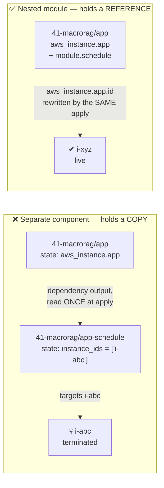

# Scheduling, observability and cost — the layer that keeps the rest honest

← [Application tiers](infra-walkthrough-app-tiers.md) · up:
[Walkthrough](infrastructure-walkthrough.md)

This covers `90-observability`, `global/cost-guardrails`, and the
`scheduler/eventbridge` module that every tier uses. They belong together because they
answer one question: **when the estate quietly does the wrong thing, how does anyone find
out?**

The honest answer, until recently, was "from the bill, two days later". That incident is
the reason this layer exists in its current form.

---

## 1. `scheduler/eventbridge` — how the estate stops billing

Module: [`scheduler/eventbridge`](../../infra/modules/scheduler/eventbridge/main.tf)

Two schedules and one role, per workload. Nothing else.

```hcl
resource "aws_scheduler_schedule" "stop" {
  schedule_expression          = "cron(${var.stop_cron})"
  schedule_expression_timezone = var.timezone
  kms_key_arn                  = var.kms_key_arn

  flexible_time_window { mode = "OFF" }

  target {
    arn      = "arn:aws:scheduler:::aws-sdk:ec2:stopInstances"   # universal target
    role_arn = aws_iam_role.scheduler.arn
    input    = jsonencode({ InstanceIds = var.instance_ids })
  }
}
```

### Why EventBridge Scheduler and not a Lambda

The **universal target** calls the EC2 API directly, so there is no function to write,
package, patch or pay for — and no Lambda execution role to review. Schedules cost $1.00
per million invocations; roughly 60 a month rounds to nothing. **The module costs
nothing; what it saves is the point.**

### The timezone is load-bearing

Use an **IANA name**, never a fixed offset. `America/New_York` keeps 22:00 local across
the daylight-saving boundary; `UTC-4` would silently drift by an hour twice a year — and
the symptom would be *"the environment goes down an hour early in November"*, which is a
miserable thing to debug. EventBridge Scheduler evaluates
`schedule_expression_timezone` natively, so DST is AWS's problem rather than ours.

Cron is six fields: `minute hour day-of-month month day-of-week year`. Day-of-month and
day-of-week are **mutually exclusive** — one must be `?`. So `0 22 * * ? *` is 22:00 every
day.

### `flexible_time_window` is OFF

A window would let the stop drift by up to its length, blurring exactly the boundary being
billed against.

### Retry policy is asymmetric, deliberately

| | Attempts | Max event age |
|---|---|---|
| **stop** | 3 | 300 s |
| **start** | 10 | 3600 s |

A missed *stop* costs a few hours of compute and the next day's schedule catches it.
Retrying a stop for hours would risk stopping the instance long after the intended window,
which is worse than missing it. A missed *start* means no egress for the whole working
day, so it retries harder and for longer.

### Least privilege on the scheduler role

- **ARN-scoped** to the specific instance ARNs, not `*`. The app permissions boundary
  *also* tag-scopes these actions to `Project=aws-genai-iac`, so two independent limits
  apply and the narrower wins.
- **Confused-deputy gate** on the trust policy: `aws:SourceAccount` must match, so a
  schedule in another account cannot assume this role.
- **Start/stop only** — deliberately not `RebootInstances` and never
  `TerminateInstances`. Stopping is recoverable; terminating is not.

The KMS grants on that role are the subtle part, and there are two distinct needs on the
same key:

1. **Decrypt the schedule's own encrypted target input** at invocation time. Without it
   the schedule fires and Scheduler cannot read its own input, so the EC2 call never
   happens.
2. **Decrypt the target instance's CMK-encrypted EBS volumes at start.** When EC2 starts
   an instance on behalf of this role, it must `Decrypt` + `GenerateDataKey` +
   `ReEncrypt` + `DescribeKey` the volume **in this role's context**. Missing these, the
   instance launches and AWS stops it seconds later with `Client.InvalidKMSKey` — and the
   schedule looks like it "didn't fire" when it did.

There is deliberately **no `kms:ViaService` condition** here, which is unusual for this
estate: Scheduler calls `kms:Decrypt` directly from its own execution environment
(CloudTrail shows `eventSource kms.amazonaws.com` with no ViaService context), so a
ViaService condition would never match. Scoping to the one key ARN on a single-purpose
role is the least-privilege bound available.

> **A manual admin start masks all of this**, because admin holds `kms:*`. "It works when
> I start it by hand but not on the schedule" is the signature of a missing KMS action on
> the scheduler role — or of the permissions boundary capping it.

### What breaks while the NAT is stopped

Private-subnet egress stops entirely. That is the intent for dev, but it means anything
scheduled overnight in a private subnet cannot reach the internet, and a private host
cannot register with SSM. If a nightly batch is ever added, either its schedule sits
inside the NAT's window or the NAT's window widens to cover it.

Also: the NAT's auto-assigned public IP is **released on stop and a new one assigned on
start**. Harmless here, because routes target the ENI — but it does mean the egress
address is not stable, so nothing may allowlist it.

---

## 2. Where a schedule must live

This is the most transferable lesson in the repository, and it cost two real incidents.



A separate `<app>-app-schedule` component stores a **copy** of the instance id. Terragrunt
dependency outputs do **not** propagate to dependents automatically, so reprovisioning the
host without re-applying that component leaves the schedule driving a terminated
instance — **silently**, because a scheduler invocation against a dead id just fails in the
background.

Both halves of that happened. The NAT instance was replaced and `nat-schedule` kept
targeting the destroyed instance. MacroRAG's schedule sat in exactly that state after a
reprovision.

The fix is not vigilance, it is structure: `compute/ec2-app` and `data/rds` instantiate
the scheduler as a **nested module**, so the target is `aws_instance.app.id` — a
reference, rewritten by the same apply that replaces the host.

```hcl
# infra/modules/compute/ec2-app/main.tf
module "schedule" {
  count  = var.start_cron != "" && var.stop_cron != "" ? 1 : 0
  source = "../../scheduler/eventbridge"

  workload     = var.app_name
  instance_ids = [aws_instance.app.id]     # ← a reference, not a copied literal
  start_cron   = var.start_cron
  stop_cron    = var.stop_cron
  timezone     = var.schedule_timezone
  enabled      = var.schedule_enabled
}
```

Two properties make this safe to adopt on a running host: the schedule resources do **not**
feed `user_data`, so adding a window to an existing host is an **add**, never a
replacement. And `workload` keys the resource names, so the same module can be
instantiated several times per environment without collisions.

The same reasoning applies to Cloud Map registration, which lives in the module for
exactly the same reason — see
[Networking §6](infra-walkthrough-networking.md#6-dns--cloud-map-not-an-internal-alb).

**The NAT and Qdrant schedules remain separate components by decision.** Both were proven
working before their schedules were added, and both are guarded by
[`test_schedule_targets.py`](../../tests/integration/test_schedule_targets.py), which
asserts each schedule's target is a live instance. That test exists precisely because this
failure is invisible at runtime.

> **`schedule_enabled = false` disables the START as well as the STOP.** It is the
> one-night-override switch, not a way to keep a host up: nothing brings the instance back
> on its own until it is set true again. A "keep it up tonight" left in place also cancels
> every future stop. For a genuine one-off, prefer a throwaway component or a manual
> start/stop over editing the daily cron.

Also: **AWS auto-starts a stopped RDS instance after 7 days.** Harmless with a daily
start; relevant if you disable the schedule while stopped.

---

## 3. `90-observability/alerts` — the channel comes first

Module: [`observability/alerts`](../../infra/modules/observability/alerts/README.md) ·
Component: [`dev/90-observability/alerts`](../../infra/environments/dev/90-observability/alerts/terragrunt.hcl)

One SNS topic per environment, `genai-dev-ops-alerts`. It lands **first** in the layer for
the same reason `cost-guardrails` leads the account: **an alarm with nowhere to publish is
not detection**, so the channel exists before the first alarm.

Per-environment, unlike the account-global *cost* topic. That separation is deliberate:
the cost topic carries spend thresholds a human reads at leisure; this one carries
"something is broken right now". Keeping dev noise off the channel that will one day carry
prod is what stops anyone learning to ignore it.

Posture: encrypted at rest, publish restricted to `cloudwatch.amazonaws.com` and
confused-deputy gated on `aws:SourceAccount`, TLS enforced
(`SNS:Publish`/`Subscribe` denied when `aws:SecureTransport` is false), and **no IAM
principal granted publish** — alarms publish as a service, and nothing in the estate needs
a human or role publishing here.

### Why the AWS-managed key, not the project CMK

Two reasons, and the second is sharper than the usual "low-value payload" carve-out. A
CMK-encrypted topic requires **every publishing principal** to hold
`kms:GenerateDataKey*`/`Decrypt` on that key — and CloudWatch publishes as a *service
principal*. A missing grant means the alarm fires, the publish is denied, and no
notification arrives: reproducing *exactly* the silent failure this component exists to
eliminate. The compensating control is a least-privilege, TLS-only topic policy, asserted
by the post-apply test.

### Email subscriptions need a human click

Terraform reports a subscription as created while it is still `PendingConfirmation`, so an
apply-only check would call a channel healthy that delivers nothing.

```powershell
# The reliable check. An unconfirmed entry has the literal string
# "PendingConfirmation" where its subscription ARN belongs.
aws sns list-subscriptions-by-topic `
  --topic-arn arn:aws:sns:us-east-1:<acct>:genai-dev-ops-alerts `
  --query "Subscriptions[].{Endpoint:Endpoint,Arn:SubscriptionArn}" --output table --region us-east-1
```

Do **not** assert on the topic's `SubscriptionsConfirmed` attribute — it is an aggregate
SNS updates lazily, by minutes. `test_ops_alerts.py` reads
`list_subscriptions_by_topic` instead; `test_cost_guardrails.py` still uses the counter
and is recorded as a known-flaky item to fix the same way.

Addresses are personal, so `alert_emails` comes from the gitignored
`account.local.hcl` — falling back to `cost_alert_emails` so a fresh clone with only the
existing override still gets a working channel. The module **fails validation on an empty
list**: a topic nobody is told about is not detection.

Cost: $0. SNS bills nothing for the first million requests a month and email notifications
are free.

---

## 4. `90-observability/scheduler-alarms` — watching the watchers

Module: [`observability/scheduler-alarms`](../../infra/modules/observability/scheduler-alarms/README.md) ·
Component: [`dev/90-observability/scheduler-alarms`](../../infra/environments/dev/90-observability/scheduler-alarms/terragrunt.hcl)

The estate makes roughly a dozen unattended API calls a day — the NAT, Qdrant, three app
hosts, the database, RagInference's scale actions — every one at an hour nobody is
watching.

> **The worked example.** On 2026-07-27 `genai-dev-qdrant-stop` fired, the EC2 call was
> **refused**, and `TargetErrorCount` recorded exactly one error. The host ran overnight.
> It took two days plus a manual investigation to establish that much. Every part of the
> failure was visible in CloudWatch at the time. **Nothing was watching.**

Two alarms:

| Metric | Means | Typical cause |
|---|---|---|
| `TargetErrorCount` | The schedule fired; the target **refused** the call | Scheduler role capped by the app permissions boundary; a stale target id; malformed target input; a resource in a state that cannot accept the action |
| `InvocationDroppedCount` | Retries exhausted, invocation **abandoned** | The action will not happen before the next day's tick — a dropped *start* means a host that never came up |

Both use `Sum > 0` over 5 minutes with `treat_missing_data = "notBreaching"`: no data means
no invocations were attempted, which is the normal state for all but a few minutes a day.

### The known gap, stated rather than hidden

**"The schedule never fired at all" is not covered**, deliberately. Scheduler's metrics
carry a `ScheduleGroup` dimension, not a `ScheduleName` one, so detecting *silence* would
mean inferring expected invocation counts per minute-of-day — noisy, and wrong at every DST
boundary. The usual reason for silence is a `DISABLED` schedule (e.g. a one-off overnight
override left in place), and that is better caught by the per-component post-apply tests,
which assert `State == "ENABLED"`.

The same dimension limit means an alarm **cannot name the schedule that failed**.
Attribute it by which schedules share that minute — the crons are in the components — or
give each workload its own schedule group later.

Cost: $0.20/month, two standard-resolution alarms at $0.10 each. Notifications are free.

### Diagnosing a schedule that did not work

```powershell
# 1. Did a target refuse a call? (readable by readonlyagent through MCP)
aws cloudwatch get-metric-statistics --namespace AWS/Scheduler --metric-name TargetErrorCount `
  --dimensions Name=ScheduleGroup,Value=default `
  --start-time 2026-07-27T00:00:00Z --end-time 2026-07-28T00:00:00Z `
  --period 3600 --statistics Sum --region us-east-1

# 2. Is the schedule even enabled, and what is it targeting?
aws scheduler get-schedule --name genai-dev-qdrant-stop --group-name default --region us-east-1

# 3. Can the scheduler role actually do what the schedule asks? AWS's own evaluator.
aws iam simulate-principal-policy `
  --policy-source-arn arn:aws:iam::<acct>:role/genai-dev-qdrant-scheduler `
  --action-names ec2:StopInstances `
  --resource-arns arn:aws:ec2:us-east-1:<acct>:instance/<id> `
  --query "EvaluationResults[].{Action:EvalActionName,Decision:EvalDecision}" --output table
```

> **Gotcha:** `scheduler get-schedule` fails for `readonlyagent`, because the target input
> is CMK-encrypted and that identity has no `kms:Decrypt`. Read it with boto3 as
> `genai-tf`, or run a no-op `terragrunt plan` on the component.

---

## 5. `global/cost-guardrails` — applied before the first meaningful spend

Module: [`cost/budgets`](../../infra/modules/cost/budgets/main.tf) ·
Component: [`global/cost-guardrails`](../../infra/environments/global/cost-guardrails/terragrunt.hcl)

This is the **first** component applied after the IAM baseline, and deliberately so: the
provisioning principles require a budget and alarm to exist *before* the first meaningful
spend, not after the first surprising bill.

Account-global rather than per-environment, because a single account has one bill. A
per-env tag-filtered budget can be added under `<env>/91-cost` once dev, staging and prod
carry distinguishable spend — which is why that layer is the one deliberately unbuilt
piece of the estate.

### The budget

```hcl
limit_amount = "150.00"      # from account.hcl: monthly_budget_usd
time_unit    = "MONTHLY"
cost_types { include_credit = false, include_refund = false, ... }
```

$150 is sized to the projected dev steady state (~$125/mo with Graviton and off-hours
scheduling), so **a breach means something is genuinely wrong** rather than being normal
growth. It is not a hard cap — AWS does not stop spend at a budget, it tells you.

Credits and refunds are excluded so the alert tracks real, payable spend.

Notifications fire at **50 / 80 / 100% of ACTUAL** spend and at **100% of FORECASTED**
month-end spend. The forecast one is the useful one: it fires when AWS projects a breach,
not once it has already happened.

### Cost Anomaly Detection catches what a budget misses

A budget cannot see one service spiking hard early in the month while the account total is
still under the cap. A `DIMENSIONAL`/`SERVICE` anomaly monitor can, with an
`IMMEDIATE`-frequency subscription thresholded on absolute impact. It is free.

> **One AWS constraint worth knowing:** AWS allows exactly **one** dimensional (SERVICE)
> monitor per account. Where the auto-created `Default-Services-Monitor` already exists,
> this resource **adopts it by name** (imported into state) rather than creating a second —
> creating fails with *"Limit exceeded on dimensional spend monitor creation"*, and
> renaming would force a replace that discards the trained baseline.

### The alert channel

Its own SNS topic (`genai-dev-cost-alerts`), encrypted with `alias/aws/sns`. That is a
deliberate carve-out from the CMK rule on two grounds: the payload is threshold
notifications rather than customer or secret data, **and this component must stand up
before the KMS component exists** — it is the first thing applied.

Publish is granted to exactly two service principals, `budgets.amazonaws.com` and
`costalerts.amazonaws.com`, each confused-deputy gated on `aws:SourceAccount` so another
account's budget cannot publish into our topic, plus the same TLS-only deny.

`aws_budgets_budget` and `aws_ce_anomaly_subscription` both `depends_on` the topic
**policy**, not just the topic — a subscriber cannot be attached before the policy permits
publishing.

The module itself costs effectively $0: AWS Budgets bills $0.02/day beyond the first two
budgets (we create one), and Cost Anomaly Detection is free.

```powershell
$env:AWS_PROFILE = "genai-tf"
aws budgets describe-budgets --account-id <acct> `
  --query "Budgets[].{Name:BudgetName,Limit:BudgetLimit.Amount,Spend:CalculatedSpend.ActualSpend.Amount}" --output table
aws ce get-anomaly-monitors --query "AnomalyMonitors[].{Name:MonitorName,Type:MonitorType}" --output table
```

---

## 6. What actually costs money, and the levers

```
  Always-on floor (~$21/mo)              Scheduled (~10 h/day)
  ┌───────────────────────────┐          ┌────────────────────────────────┐
  │ EBS volumes 208GB $16.30  │          │ RagInference 8vCPU/16GB $95.00 │ ← the big one
  │ 5 secrets          $2.00  │          │ qlp     t4g.large       $23.60 │
  │ KMS CMKs (3)       $1.00  │          │ macrorag t4g.small      $22.56 │
  │ ECR + S3          ~$1.00  │          │ arag     t4g.small      $22.56 │
  │ Route53 zone       $0.50  │          │ qdrant   t4g.small       $8.00 │
  │ Cloud Map          $0.30  │          │ RDS db.t4g.micro         $5.05 │
  │ 2 alarms           $0.20  │          │ NAT      t4g.nano        $3.97 │
  └───────────────────────────┘          └────────────────────────────────┘
  Not billing today: the ALB ($16.43/mo when ingress_mode = "alb")
```

The floor figures are **measured**, from Cost Explorer's per-service daily usage rather
than list-price arithmetic. Note Cost Explorer reports $0 for this account unless you
filter to `RECORD_TYPE = Usage` — promotional credits net the totals to zero, so the
default view hides the entire bill:

```powershell
aws ce get-cost-and-usage --time-period Start=<from>,End=<to> --granularity DAILY `
  --metrics UnblendedCost --group-by Type=DIMENSION,Key=SERVICE `
  --filter '{\"Dimensions\":{\"Key\":\"RECORD_TYPE\",\"Values\":[\"Usage\"]}}' --region us-east-1
```

EBS overtook every other floor item once Faultline and the ingest runner landed —
208 GB across nine volumes, billing whether or not an instance is attached. It is now
79% of the cost of a fully parked estate.

### Park mode — the whole environment off

`parked = true` in `dev/env.hcl` holds every tier down indefinitely, taking the estate
from roughly $4/day to $0.68/day without destroying anything. Each tier parks
differently, and the RDS case is the one that bites:

| Tier | Parked state | Why not the obvious thing |
|---|---|---|
| EC2 | both crons DISABLED | — a stopped instance never restarts itself |
| ECS | scale-up action dropped, target max 0 | the *bound* is what holds it down; Auto Scaling scales in a running task rather than waiting for 21:00 |
| RDS | stop cron KEPT, start cron dropped | **disabling both would let AWS's seven-day force-start bring it back with nothing left to stop it** |

The full rationale — how the spend was measured, and why the obvious "disable the
schedules" approach is wrong for RDS — is in
[`../design/park-mode.md`](../design/park-mode.md). Operator procedure, including
waking it up in dependency order, is in
[`../runbooks/day2-operations.md` §11](../runbooks/day2-operations.md#11-park-the-environment-and-wake-it-up).

| Resource | Idle cost | Control |
|---|---|---|
| RagInference (8 vCPU / 16 GB ARM Fargate) | **~$0.32/hr** | scale the Application Auto Scaling *bounds* to 0 — the biggest single lever |
| Faultline host (`t4g.large`) | ~$0.067/hr | `start_cron`/`stop_cron` on `40-quantlibpricer/app` |
| RDS `genai-dev-arag` | ~$0.016/hr running; **~$2.30/mo storage bills while stopped** | schedule inside `42-arag/db`, 10:45–21:10 |
| EC2 app / Qdrant hosts (`t4g.small`) | ~$0.017/hr each | schedule folded into each app component |
| NAT instance | ~$0.005/hr + $3.60/mo public IPv4 while running | `00-networking/nat-schedule`, 10:00–22:00 |
| EBS volumes | **bills while stopped — the floor** | `root_volume_gb` is the number that costs money 24×7 |

Two things worth repeating because they are counter-intuitive:

- **Stopping halves an RDS line, it does not zero it.** Storage and backups bill whether
  the instance is up or not.
- **EBS is why root volumes are small.** 30 GB rather than a comfortable 100 GB is a
  deliberate around-the-clock saving on a host that is off 14 hours a day.

---

## 7. What is still open in this layer

Recorded so it is a decision rather than tribal knowledge. Nothing here blocks the
running system.

| Item | Status |
|---|---|
| **Resource alarms** | Missing: EC2 status checks, RDS CPU/storage/connections, data-volume disk usage. The channel and the scheduler alarms exist; these do not. |
| **A dashboard** | Not built. |
| **RagInference's inline ECS alarms** | Defined in `compute/ecs-service` rather than in the observability module, so there are two definitions of "an alarm" in the estate. Folding them in is outstanding. |
| **`91-cost`** | Deliberately unbuilt — `global/cost-guardrails` already carries the budget and anomaly detection. Earns its keep only once environments carry distinguishable spend. `cost/tags` and `cost/anomaly-detection` sit unreferenced and want reconciling with it. |
| **`test_cost_guardrails.py`** | Asserts on SNS's lazily-updated `SubscriptionsConfirmed` counter; `test_ops_alerts.py` shows the fix. |

---

## 8. Verification

```powershell
$env:AWS_PROFILE = "genai-tf"
conda run -n py312 pytest tests/integration -m integration -v `
  -k "ops_alerts or scheduler_alarms or schedule_targets or nat_schedule or arag_db_schedule or qlp_schedule or cost_guardrails"
```

The two assertions that matter most in this layer are the ones an apply cannot give you:
that the alert topic has a **confirmed** subscriber, and that every schedule's target is a
**live** instance.

---

← [Application tiers](infra-walkthrough-app-tiers.md) ·
up: [Walkthrough](infrastructure-walkthrough.md) ·
day-to-day commands: [`../runbooks/day2-operations.md`](../runbooks/day2-operations.md)
