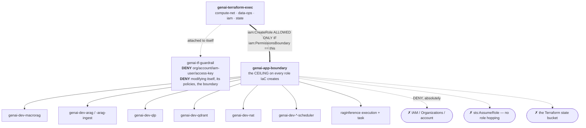
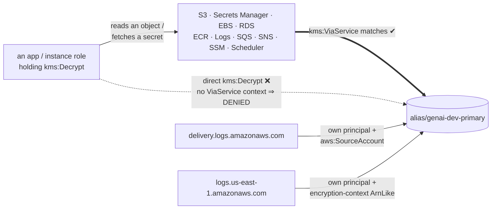

# `10-security` + the IAM baseline — keys, secrets, and the containment model

← [Networking](infra-walkthrough-networking.md) · up:
[Walkthrough](infrastructure-walkthrough.md) · next:
[Data stores →](infra-walkthrough-data.md)

Three things here, and they answer three different questions:

- **`10-security/kms`** — one customer-managed key, and a key policy that stops a
  leaked credential from bulk-decrypting anything.
- **`10-security/secrets`** — secret *containers*, deliberately without their values.
- **`global/iam-baseline`** — the role Terraform runs as, and the permissions boundary
  that caps every role Terraform creates.

The last one is the most important idea in the repository: **Terraform must not be
able to mint a role more powerful than itself.**



An app role's effective permissions are the **intersection** of its own policy and
that boundary — so a role created by IaC can never escalate, regardless of what its
inline policy says.

---

## 1. `kms` — one CMK per environment

Module: [`security/kms`](../../infra/modules/security/kms/main.tf) ·
Component: [`dev/10-security/kms`](../../infra/environments/dev/10-security/kms/terragrunt.hcl)

One key per *environment*, not per data store, aliased `alias/genai-dev-primary`.
Per-store keys give finer blast-radius isolation, but each carries a fixed
**$1/month** charge and the isolation only pays off when different stores have
genuinely different access populations. At dev scale that is paying for separation
nobody enforces. Prod can split later — that is a key-policy change plus a
re-encrypt, not a redesign.

Settings that matter: `SYMMETRIC_DEFAULT` / `ENCRYPT_DECRYPT` (the only spec S3, EBS,
RDS and CloudWatch Logs server-side encryption accept), automatic rotation **on** at
365 days, and a 7-day deletion window in dev (short, because teardown should be cheap
and there is no data worth a 30-day grace period — prod must raise this).

Everything downstream references the **alias**, never the key id, so a future key
replacement does not require editing every consumer.

### The key policy has four statements, and each closes a specific failure

A KMS key policy is unusual in AWS: it is **authoritative**. Unlike almost every
other resource, IAM permissions alone do *not* grant access to a key.

**① Anti-lockout — delegate to the account root.**

```hcl
statement {
  sid = "EnableIAMPolicyDelegation"
  principals { type = "AWS", identifiers = ["arn:aws:iam::${var.account_id}:root"] }
  actions   = ["kms:*"]
  resources = ["*"]
}
```

This looks alarming and is AWS's documented requirement. `kms:*` to the account root
does not hand out access — it means *"defer the decision to IAM policies"*, which is
exactly how the exec role's scoped KMS grants take effect. Omit it and the key becomes
permanently unmanageable the moment the administering principal is deleted, with no
recovery path and the encrypted data lost with it.

**② The control that actually matters — `kms:ViaService`.**

```hcl
statement {
  sid     = "AllowUseViaAwsServices"
  actions = ["kms:Encrypt", "kms:Decrypt", "kms:ReEncrypt*", "kms:GenerateDataKey*", "kms:DescribeKey"]
  condition { test = "StringEquals", variable = "kms:ViaService", values = local.via_service_principals }
  condition { test = "StringEquals", variable = "kms:CallerAccount", values = [var.account_id] }
}
```



`via_services` is an explicit list — `s3`, `secretsmanager`, `ssm`, `sns`, `sqs`,
`logs`, `ecr`, `rds`, `dynamodb`, `backup`, `ebs`, `elasticfilesystem`, `scheduler`.
The effect: **a principal cannot call `Decrypt` directly against this key.** Only
those services may, and only while acting for a caller in this account. So a leaked
role credential cannot bulk-decrypt ciphertext outside the service path that produced
it. Every entry widens the data plane, which is why the list is curated rather than
generous.

**③ Grant management, gated to AWS resources.** RDS, EBS and Backup create grants on
the caller's behalf when they attach an encrypted volume or snapshot. Without
`kms:CreateGrant` the call fails at resource-creation time with a `KMSGrantMissing`
-style error. The `kms:GrantIsForAWSResource` condition is load-bearing, not
decoration: an unconstrained `CreateGrant` is an escalation path, because a grant can
delegate key use to an arbitrary principal.

**④ Two service principals that `ViaService` does not cover.**
`delivery.logs.amazonaws.com` (flow logs, ALB access logs) and
`logs.<region>.amazonaws.com` (CloudWatch Logs) call KMS with their **own** principal
rather than on behalf of a requester, so the `ViaService` condition never matches.
Each gets its own statement — the log-delivery one gated on `aws:SourceAccount`, the
CloudWatch one gated by *encryption context* to log groups in this account and region,
so the grant cannot be used against log groups elsewhere.

> Omit ④ and nothing errors. AWS reports the flow log as active and silently writes
> nothing. This is the single most repeated failure shape in the estate: **a missing
> KMS grant usually presents as a networking or configuration problem, never as a
> permissions one.**

### Checkov and KMS key policies

Three skips sit on this document, and they are worth understanding because they are
structural rather than convenient:

- `CKV_AWS_356` (`"*"` as a resource) is unavoidable in **any** KMS key policy —
  `Resource` refers to the key the policy is attached to, and naming the key's own ARN
  is self-referential, which Terraform cannot resolve without a cycle. Every valid key
  policy AWS publishes uses `"*"`.
- `CKV_AWS_109` / `CKV_AWS_111` flag the root delegation, i.e. statement ①, whose
  omission breaks the key permanently.

The compensating control is [`test_kms.py`](../../tests/integration/test_kms.py),
which asserts the `ViaService` and `CallerAccount` confinement against the live key.

```powershell
# Read the live key policy back (as genai-tf; MCP for readonlyagent)
aws kms get-key-policy --key-id alias/genai-dev-primary --policy-name default `
  --query Policy --output text --region us-east-1 | ConvertFrom-Json | ConvertTo-Json -Depth 10

aws kms get-key-rotation-status --key-id alias/genai-dev-primary --region us-east-1
```

---

## 2. `secrets` — containers, never values

Module: [`security/secrets`](../../infra/modules/security/secrets/main.tf) ·
Component: [`dev/10-security/secrets`](../../infra/environments/dev/10-security/secrets/terragrunt.hcl)

This module creates `aws_secretsmanager_secret` and **never**
`aws_secretsmanager_secret_version`. That is the entire point.

**A secret value placed in Terraform is a secret in the state file, in plaintext,
forever** — every historical version of it, readable by anyone who can read the state
bucket, and printed in plan output. Marking an output `sensitive` hides it from the
console; it does nothing to the state. So the value is set out of band, by a human or
a rotation function, and Terraform manages only the container, its encryption and its
access policy.

The practical consequence is intended: **an application cannot start until someone
sets the value.** A missing secret should fail loudly at deploy time, not silently
resolve to an empty string. Several component headers list "set the secret value"
among the out-of-band prerequisites for exactly this reason.

### One secret per application, not per key

Four exist: `genai-dev/{macrorag,qdrant,arag,qlp}/app`. Secrets Manager bills **$0.40
per secret per month regardless of size**, and an application needs all of its own
keys anyway — so adding a new credential to an existing app is an out-of-band value
edit with no infrastructure change at all.

They are encrypted with the project CMK rather than the AWS-managed
`aws/secretsmanager` key, because the managed key cannot carry a scoped key policy and
does not rotate on our schedule — a secret encrypted under it sits outside every
control the KMS module establishes.

### The second gate: a per-secret resource policy

```hcl
statement {
  sid       = "DenyPrincipalsOutsideTheReaderSet"
  effect    = "Deny"
  principals { type = "AWS", identifiers = ["*"] }
  actions   = ["secretsmanager:GetSecretValue"]
  condition { test = "ArnNotLike", variable = "aws:PrincipalArn", values = each.value.reader_role_arn_patterns }
}
```

With this attached, reading a secret requires **both** an IAM grant *and* a principal
matching one of that secret's permitted patterns — so an over-broad IAM policy
elsewhere in the account cannot on its own expose it. It is written as
deny-with-exception rather than a bare allow, so adding an unrelated `Allow` somewhere
else cannot widen it.

It is **per secret**. A single component-wide reader list would attach one
application's readers to another application's secret, locking the real owner out of
its own credential.

The reader ARNs are **constructed, not taken as a dependency** —
`arn:aws:iam::<acct>:role/genai-dev-arag` — because the app components depend on *this*
component, so a dependency back would be a cycle. Role names are deterministic
(`<prefix>-<app>`), which makes that safe.

> **This is load-bearing and it has bitten.** `ArnNotLike` does **not** wildcard, so
> `genai-dev-arag` does not cover `genai-dev-arag-ingest` — the ingest runner needed
> its own ARN listed explicitly. And when a host's role name does not match, the
> refusal lands inside cloud-init under `set -euo pipefail`: the box boots, aborts
> before pulling an image, and leaves nothing on disk explaining why. That is exactly
> how XbrlRag's ingest runner failed. The ARNs are listed individually rather than as
> `genai-dev-arag*` so the exception set stays enumerable — a glob would silently
> admit every future role whose name starts with the app's.

### Rotation is off, deliberately, and that is a per-credential judgement

`CKV2_AWS_57` wants automatic rotation. Rotation is not a generic operation — it means
calling the credential issuer's rotation API. For an RDS password AWS ships a working
rotator and rotation should absolutely be on; for a third-party LLM API key there is
no such thing, and several vendors offer no rotation API at all. **Enabling rotation
without a working rotator is worse than leaving it off**: the secret reports itself as
rotating while nothing happens, so a stale credential looks managed. There is a test
asserting rotation is not falsely advertised.

Which is why XbrlRag's database credential is **not** in its app secret: RDS uses an
AWS-managed master-user secret that rotates on RDS's schedule, and the app reads it
directly. Copying it into a second place would create something that can drift. See
[Application tiers](infra-walkthrough-app-tiers.md#3-42-arag--the-only-tier-with-a-database).

### Setting a value

```powershell
$env:AWS_PROFILE = "genai-tf"

# KEY=value lines, rendered verbatim into the compose env-file by the host bootstrap
aws secretsmanager put-secret-value --secret-id genai-dev/arag/app `
  --secret-string "OPENAI_API_KEY=sk-...`nJINA_API_KEY=jina_..." --region us-east-1

# JSON object form (Qdrant expects {api_key})
aws secretsmanager put-secret-value --secret-id genai-dev/qdrant/app `
  --secret-string '{"api_key":"..."}' --region us-east-1

# Confirm a value EXISTS without printing it
aws secretsmanager describe-secret --secret-id genai-dev/arag/app `
  --query "{Name:Name,Kms:KmsKeyId,Changed:LastChangedDate}" --region us-east-1
```

The module also emits a `set_value_commands` output that prints the exact commands for
each secret it created.

---

## 3. The Terraform execution role

Module: [`security/iam-terraform-role`](../../infra/modules/security/iam-terraform-role/main.tf) ·
Component: [`global/iam-baseline`](../../infra/environments/global/iam-baseline/terragrunt.hcl) ·
Runbook: [`../runbooks/terraform-execution-role.md`](../runbooks/terraform-execution-role.md)

This one component creates: the `genai-terraform-exec` role, five customer-managed
policies, the `genai-app-boundary` permissions boundary, and the thin `tfuser`.

### Power lives on a role, not on a user

`tfuser` holds exactly one permission — `sts:AssumeRole` on the exec role — so its
long-lived access key carries **no standing power**. Every actual grant hangs off the
role, assumed for short-lived credentials.

The module supports a `direct-attach` mode where the five policies hang straight off
the user. This deployment uses `assume-role`, so that path yields `{}` and creates
nothing; the trade-off is documented on the variable, and the `checkov` skip for it
says plainly that the finding is legitimate for anyone who switches.

The trust policy has a precondition worth noting: if there are no explicit trusted
principals *and* no `tfuser`, trust would fall back to the account root — which widens
it to every principal in the account. The module refuses to build in that state unless
`require_mfa = true`.

### Five policies, and what each is for

| Policy | Grants | How it is confined |
|---|---|---|
| `genai-tf-compute-net` | `ec2:*`, `elasticloadbalancing:*`, `autoscaling:*`, `application-autoscaling:*`, `ecs:*`, `ecr:*`, `servicediscovery:*` | `aws:RequestedRegion = us-east-1`. Plus `route53:*`/`acm:*` globally (those services accept no region condition) |
| `genai-tf-data-ops` | `rds`, `backup`, `dynamodb`, `sqs`, `logs`, `cloudwatch`, `sns`, `scheduler`, `events` | same region lock |
| `genai-tf-iam` | create/manage the per-tier app roles | **boundary-conditioned** — see below |
| `genai-tf-state` | `GetObject`/`PutObject`/`DeleteObject` on the state bucket, `ListBucket`/`GetBucketVersioning` on the bucket | nothing else — no backend-creation rights |
| `genai-tf-guardrail` | **Deny** | the fence, see below |

Several grants are ARN-scoped rather than region-locked, because scoping is stronger
where it is possible:

- **S3** is a global namespace, so no region lock — but the grant *is* scoped to
  `arn:aws:s3:::genai-*`. This one was a real finding and a real fix: the policy
  previously read `s3:*` on `*`, which let a single assumable identity delete **any
  bucket in the account**. Note the state bucket is deliberately *excluded* from
  `data_ops` — it has its own narrow policy, so `data_ops` cannot destroy the state
  backend it depends on.
- **Secrets Manager** is scoped to `genai-*`, so the exec role cannot read every
  secret in the account. A second, narrower statement allows only `CreateSecret` and
  `TagResource` on the AWS-reserved `rds!*` prefix — RDS creates its managed
  master-user secret *as the caller* during `CreateDBInstance`. Deliberately **no
  `GetSecretValue`** there: the password never touches Terraform state or this role's
  reads; the app tier reads it at runtime under its own grant.
- **KMS destructive verbs** (`ScheduleKeyDeletion`, `PutKeyPolicy`, `DisableKey`, …)
  are gated on `aws:ResourceTag/Project = aws-genai-iac`, so the exec role cannot
  delete or re-police an unrelated CMK. Create/read/use is broader because a fresh
  key's ARN is a UUID, unknown at policy-write time.
- **SSM is read-only** (`DescribeInstanceInformation` and friends), with no
  `SendCommand`, no `StartSession` and no parameter access. It exists so post-apply
  verification can ask *"is this instance a registered managed node?"* — the single
  check that proves an instance's role, the boundary and the agent all work together.
  Without it that check could only run as `readonlyagent` through MCP, which pytest
  cannot reach, so it would stay a manual step forever.
- **`iam:Simulate*`** is included in the read-only IAM statement so negative policy
  tests can run automatically, asserting that what should be denied *is* denied using
  AWS's own evaluator rather than a comment claiming it. Marginal disclosure is zero —
  `iam:Get*`/`List*` already exposes every policy document in the account.

### The escalation control: `CreateRole` requires *our* boundary

```hcl
statement {
  sid       = "CreateRoleWithBoundary"
  actions   = ["iam:CreateRole", "iam:PutRolePermissionsBoundary"]
  resources = ["arn:aws:iam::<acct>:role/genai-*"]
  condition {
    test     = "StringEquals"
    variable = "iam:PermissionsBoundary"
    values   = [local.boundary_arn]
  }
}
```

This is the line that stops *"Terraform mints a role more powerful than itself."* The
exec role can create app roles — but **only** if each carries the `genai-app-boundary`
permissions boundary. A `CreateRole` call without a boundary, or with
`AdministratorAccess` as the boundary, is refused.

`PassRole` is doubly scoped: to `genai-*` roles **and** by `iam:PassedToService`, to
the nine services that legitimately launch them (`ec2`, `ecs-tasks`, `ecs`,
`application-autoscaling`, `scheduler`, `backup`, `monitoring.rds`,
`vpc-flow-logs`, `events`). `CreateServiceLinkedRole` is scoped by
`iam:AWSServiceName` to a named list, so it cannot create arbitrary roles.

### The deny guardrail, including self-protection

```hcl
statement {
  sid     = "DenyAccountAndUsers"
  effect  = "Deny"
  actions = ["organizations:*", "account:*", "iam:*User*", "iam:*AccessKey*",
             "iam:*LoginProfile*", "iam:*SAMLProvider*", "iam:*OpenIDConnectProvider*",
             "iam:CreateAccountAlias", "iam:DeleteAccountAlias",
             "iam:UpdateAccountPasswordPolicy"]
}
```

Plus `ProtectSelfAndBoundary`, which denies the exec role the ability to modify its
own role, its five policies, or the boundary; and `DenyBoundaryRemoval`, which stops
any `genai-*` role having its boundary stripped.

Because an explicit `Deny` always wins in IAM evaluation, this is what makes the broad
`ec2:*`-style grants above acceptable: the fence is evaluated on the same role.

> **An expected plan artefact.** Whenever any referenced policy is changing,
> `terraform plan` reports the guardrail policy as "will be updated in-place" and may
> render its whole document as `(known after apply)`. That is because the provider
> treats the referenced `.arn` attributes as not-yet-known while those resources are
> updating. At apply the ARNs resolve unchanged, the document is byte-identical, and
> nothing is written — verified by the live policy still being at v1 with
> `UpdateDate == CreateDate` after three applies. Do **not** "fix" it by substituting
> constructed ARN strings: that would silence the diff at the cost of a security
> policy that silently drifts if a policy is renamed.

### `genai-app-boundary` — the ceiling on every role Terraform creates

A permissions boundary is not a grant. It defines the **maximum** privilege a role may
ever hold; an identity is limited to the *intersection* of its boundary and its
policies, so a role with this boundary and no policies can do precisely nothing.

Allowed (i.e. *permitted to be granted*), all namespace-scoped:

| Statement | Covers |
|---|---|
| `RuntimeObjectStore` | S3 object + list ops on `genai-*` buckets only |
| `RuntimeMessaging` | SQS on `genai-*` queues |
| `RuntimeSecretsAndConfig` | `GetSecretValue` on `genai-*` secrets, SSM parameters under `genai/` |
| `RuntimeRdsManagedSecret` | `GetSecretValue` on `rds!*` — outside `genai-*`, needed for an RDS-backed app tier to read its own DB password |
| `RuntimePlatform` | `kms:Decrypt`/`GenerateDataKey*`/`ReEncrypt*`/`DescribeKey`, ECR pull, `logs:PutLogEvents`, `cloudwatch:PutMetricData`, `rds-db:connect`, `ec2:Describe*` |
| `RuntimeKmsGrantsForAwsResources` | `CreateGrant`/`ListGrants`, gated on `kms:GrantIsForAWSResource` |
| `RuntimeInstanceScheduling` | `ec2:StartInstances`/`StopInstances`, **tag-scoped** to `Project=aws-genai-iac` |
| `RuntimeDatabaseScheduling` | `rds:StartDBInstance`/`StopDBInstance`, **ARN-scoped** to `genai-*` |
| `RuntimeSsmManagedNode` | the `ssmmessages`/`ec2messages` session transports and the SSM agent's control-plane calls |

Denied absolutely:

```hcl
statement { sid = "DenyStateBucket",       effect = "Deny", actions = ["s3:*"], resources = [state bucket] }
statement { sid = "BoundaryDenyEscalation", effect = "Deny",
            actions = ["iam:*", "organizations:*", "account:*", "sts:AssumeRole"] }
```

So **no app role can ever touch IAM, the org, the account, or hop to another role**,
regardless of its own inline policy — and none can read Terraform state (belt and
suspenders: the state bucket is never named `genai-*`, but denying it explicitly means
no future boundary edit can expose it). With S3-native locking the lock object lives
in that same bucket, so one statement covers state and locks.

> **The boundary's failure mode is silence, and it has produced three real
> incidents.** Because a boundary caps rather than grants, a missing action does not
> error at apply time — it makes something quietly not work:
>
> - Without `RuntimeSsmManagedNode`, an instance role carrying
>   `AmazonSSMManagedInstanceCore` is capped to nothing and Session Manager fails as
>   though it were a *networking* fault: the instance simply never appears as a
>   managed node.
> - Without `RuntimeInstanceScheduling`, the scheduler role is capped to nothing and
>   the schedule **fires successfully, reports success, changes nothing**, and shows up
>   only on the bill.
> - Without `ReEncrypt*`/`DescribeKey`/`CreateGrant`, a scheduled start of an instance
>   with a CMK-encrypted volume launches and is then stopped by AWS seconds later with
>   `Client.InvalidKMSKey` — which reads as "the schedule didn't fire" when it did. A
>   manual admin start masks this entirely, because admin holds `kms:*`.
>
> Whenever new infrastructure "works when I do it by hand but not on a schedule", the
> boundary is the first place to look.

### Proving containment, not asserting it

```powershell
$env:AWS_PROFILE = "genai-tf"
conda run -n py312 pytest tests/integration/test_exec_role_containment.py -m integration -v
```

That test uses `iam:SimulatePrincipalPolicy` — AWS's own policy evaluator — to confirm
twelve escalation actions come back `explicitDeny`, and that `CreateRole` is refused
without our boundary and refused with `AdministratorAccess` as the boundary. This is
the compensating control cited by the `checkov` skips on the broad grants, and it is
evidence a static scanner structurally cannot produce.

By hand, for a single question:

```powershell
# Can the exec role delete an IAM user?  Expect explicitDeny.
aws iam simulate-principal-policy `
  --policy-source-arn arn:aws:iam::<acct>:role/genai-terraform-exec `
  --action-names iam:DeleteUser `
  --query "EvaluationResults[].{Action:EvalActionName,Decision:EvalDecision}" --output table
```

---

## 4. Applying this layer

`global/iam-baseline` is the **one** component a human admin applies, because the exec
role cannot create itself and its guardrail denies `iam:*User*` so it can never create
`tfuser` either.

```bash
# As the ADMIN identity — task iam-baseline refuses to run AS the exec role
task iam-baseline
```

Everything else is normal:

```powershell
$env:AWS_PROFILE = "genai-tf"
cd infra/environments/dev/10-security/kms
terragrunt apply
cd ../secrets
terragrunt apply
```

> **The admin-apply gate is a commit gate.** Nothing that depends on an un-applied
> admin step gets committed or pushed until the human has applied it *and*
> verification passes. This has been violated once — an exec-role S3 scoping fix was
> pushed while its apply was outstanding, leaving `main` asserting a security property
> that was not yet true in AWS.

---

← [Networking](infra-walkthrough-networking.md) ·
[Data stores →](infra-walkthrough-data.md)
