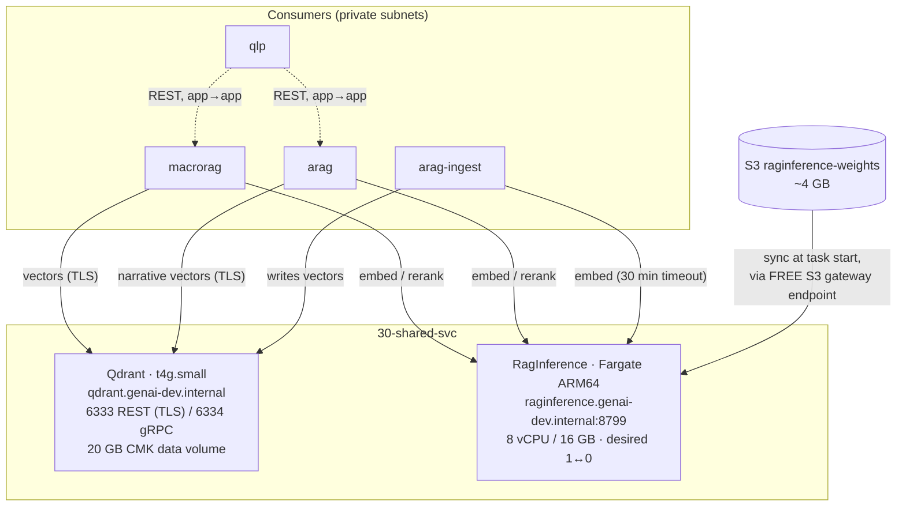

# `30-shared-svc` — the two services everything else calls

← [Data stores](infra-walkthrough-data.md) · up:
[Walkthrough](infrastructure-walkthrough.md) · next:
[Application tiers →](infra-walkthrough-app-tiers.md)

Two shared services, on deliberately different compute substrates, plus a load
balancer that currently creates nothing.

- **Qdrant** — a vector store shared by MacroRAG and XbrlRag (separate collections), on a
  dedicated EC2 host with its own EBS data volume.
- **RagInference** — an embedding + reranking model server on ECS Fargate, ARM64, CPU
  only, scaled to zero off-hours.
- **The ALB** — code that exists so it can be switched on, and is currently off.



Both are reached by **Cloud Map name**, never by IP, and neither is behind a load
balancer. That is a design decision, not an omission — see
[Networking §6](infra-walkthrough-networking.md#6-dns--cloud-map-not-an-internal-alb).

---

## 1. Qdrant — self-hosted, and why

Module: [`data/qdrant`](../../infra/modules/data/qdrant/README.md) ·
Component: [`dev/30-shared-svc/qdrant`](../../infra/environments/dev/30-shared-svc/qdrant/terragrunt.hcl) ·
Analysis: [`../design/qdrant-cloud-vs-self-hosted.md`](../design/qdrant-cloud-vs-self-hosted.md) §6a

The question was Qdrant Cloud vs self-hosted, and then — having chosen self-hosted —
*where*. Co-locating it inside one app host would have been cheaper still, and was
rejected: **it is shared by two subsystems and must not inherit one consumer's restart
domain.** MacroRAG reprovisioning its host would otherwise take XbrlRag's vector store
down with it.

What the component builds:

| Resource | Detail |
|---|---|
| EC2 host | `t4g.small` (Graviton, 2 vCPU / 2 GB), AL2023 arm64, **private subnet, no public IP**, IMDSv2 required |
| Root volume | 20 GB gp3, CMK-encrypted |
| **Separate** data volume | 20 GB gp3, CMK-encrypted, attached at `/dev/sdf`, mounted at `/var/lib/qdrant` |
| Instance role | SSM core + ARN-scoped ECR pull of *its own* image + read of *its own* secret; carries the permissions boundary |
| Cloud Map A record | `qdrant.genai-dev.internal` |

Placement is pinned to `us-east-1a` — the same AZ as the NAT instance and all four app
tiers — so every vector query and ingest write is same-AZ ($0 transfer) and off the NAT
path.

### The data volume is separate from root, on purpose

Vector data survives instance replacement and carries its own snapshot lifecycle. Two
details make stop/start safe:

- The volume is mounted **by filesystem label**, not by device name — resilient to NVMe
  renaming across a stop/start.
- `qdrant.service` is a **systemd unit**, so the container comes back on every boot from
  the cached image. Nothing load-bearing lives in one-shot cloud-init beyond first-boot
  setup. (Same lesson as the NAT instance's iptables rules.)

### Configuration by environment variable, not a mounted YAML

The bootstrap writes a root-only (`0600`) `QDRANT__*` env-file consumed via systemd
`--env-file`. Env vars have the highest precedence in Qdrant and are **always read**, so
the security-critical settings (TLS, API key) cannot be silently ignored the way a
`production.yaml` could be if `RUN_MODE` did not load it.

### TLS is on; auth is deliberately off (for now)

TLS on 6333/6334 uses a **self-signed** certificate generated at boot. Self-signed
rather than ACM because the store is internal-only and has no domain — consumers either
trust the cert or skip verification in-VPC. So in-transit encryption *is* on, unlike the
ALB's documented no-TLS relaxation.

API-key auth, however, is currently **off**: the component passes `secret_arn = ""`.

> **This is a time-bounded, written-down relaxation.** It exists so the host, data
> volume, TLS and service discovery could be validated before the org-wide secrets pass
> set the key — not as an end state. What is still enforced: TLS, a private subnet with
> no public IP, **SG-to-SG ingress only** from consumer groups (no CIDR admits), egress
> to AWS services only, and no real data in dev. The running host writes
> `/var/log/qdrant-authoff-warning` while relaxed. Closing it is two lines — set
> `secret_arn` to the wired `genai-dev/qdrant/app` secret and re-apply, after which the
> bootstrap enforces the key and the instance role gains a scoped secret read. **It must
> be closed before any real data lands, and always in prod.**

### `imds_hop_limit = 2`, deliberately not 1

Everywhere else in the estate the IMDS hop limit is 1, which stops a container reaching
instance metadata and assuming the instance role — the standard
container-escape-to-credentials path. Qdrant needs 2, because the *containerised* Qdrant
requires instance-role credentials for its boot-time ECR pull and secret read, and a
container adds one hop. The compensating control is that the role is ARN-scoped to
exactly one repository and one secret.

### The image is mirrored and pinned

```hcl
image_tag = "v1.18.2"
image     = "${dependency.ecr.outputs.repository_urls["genai-dev/qdrant"]}:${local.image_tag}"
```

The upstream `qdrant/qdrant` arm64 image is mirrored into our ECR (see
[Data stores §3](infra-walkthrough-data.md#why-upstream-images-are-mirrored-rather-than-pulled)).
The repository is `IMMUTABLE`, so a version tag is a reliable pin; switching to
`@sha256:<digest>` gives full digest pinning. Note the URL comes from the ECR
*dependency* rather than being written out, so no account id appears in this file.

### Cost

~$5/mo compute on the 11:00–21:00 window (`t4g.small` at ~10 h/day) + ~$3/mo EBS (20 GB
root + 20 GB data) ≈ **~$8/mo**. arm64 for the ~20% Graviton saving. The schedule is a
separate component — see [§4](#4-the-two-schedules-that-stayed-separate).

### Consuming it

```powershell
# From a laptop: tunnel through ANY instance, then open the dashboard.
# https, self-signed — and use a DISTINCT local port or a local Qdrant silently wins.
aws ssm start-session --target <any-instance-id> `
  --document-name AWS-StartPortForwardingSessionToRemoteHost `
  --parameters host="qdrant.genai-dev.internal",portNumber="6333",localPortNumber="16333" `
  --region us-east-1 --profile <ssm-profile>
# then browse https://localhost:16333/dashboard
```

From application code the endpoint is `https://qdrant.genai-dev.internal:6333` with
verification off (the cert's CN is the internal name). Client-side details, including the
`qdrant-client` 1.18 `verify` + `check_compatibility` interaction, are in
[`consuming-shared-services.md`](consuming-shared-services.md).

---

## 2. RagInference — Fargate, ARM64, and no GPU

Module: [`compute/ecs-service`](../../infra/modules/compute/ecs-service/README.md) ·
Component: [`dev/30-shared-svc/raginference`](../../infra/environments/dev/30-shared-svc/raginference/terragrunt.hcl)

The shared model server: a BGE-M3 embedder and a Jina reranker that MacroRAG and XbrlRag
both call for embeddings and reranking.

**No GPU.** A GPU instance would idle at ~$380–730/month, and these are CPU-tolerable
models for a batch-shaped workload. CPU Fargate on ARM64 instead, scaled to zero
off-hours. That single decision is the largest cost avoidance in the estate.

**Fargate rather than the `ec2-app` compose pattern** because this is the one workload
that genuinely benefits: it has no local state, its weights come from S3, and *it can
scale to zero* — a stopped EC2 instance still bills its EBS volume, whereas a Fargate
service at `desiredCount = 0` bills nothing at all. There is also no cluster charge.

### Sizing, and why it changed

```hcl
cpu              = 8192     # 8 vCPU
memory           = 16384    # 16 GB
cpu_architecture = "ARM64"
```

It started at 4 vCPU. The bump was for **query latency, not ingest**:
`jina-reranker-v3` is *listwise*, so one narrative rerank is a handful of 4096-token
forward passes of a 0.6 B model — and on 4 vCPU that measured **over 10 minutes**, past
every client timeout. Rerank throughput is roughly linear in vCPU, so 8 vCPU is ~2×,
and XbrlRag reducing its `prefetch_limit` from 30 to 10 took another ~3× off the token
count. Memory stays at 16 GB because that is the 8-vCPU Fargate minimum and 4 vCPU never
approached it. Cost: $0.186 → $0.316/hr, i.e. ~$56 → ~$95/mo on the schedule.

The component records the exception too: a full-corpus index is CPU-bound (bge-m3 at
~6 s/text), so a one-time bulk ingest is worth temporarily raising to 16 vCPU / 32 GB —
**and reverting afterwards.** That bump is explicitly not to be committed; steady state
is 8/16.

### Weights come from S3 at task start

```hcl
environment = {
  MODEL_SOURCE = "s3"
  MODEL_S3_URI = "s3://genai-dev-raginference-weights-us-east-1"
  HF_HOME      = "/models"
  RERANKER     = "jina"
  EMBEDDER     = "bge"
}
```

The ~4 GB sync rides the **free S3 gateway endpoint**, so it never touches the NAT
instance. Note only non-secret configuration is here; anything secret would go in the
`secrets` input (`valueFrom`), never in `environment`.

`readonlyRootFilesystem` is therefore `false` — the task writes those 4 GB to `HF_HOME`
at startup, so a read-only root would break the documented model sync. Compensating: the
task carries no long-lived on-disk secret and is replaced rather than patched.

### The health check gates DNS registration

```hcl
container_health_check = {
  command      = ["CMD-SHELL", "python -c '...urlopen(\"http://127.0.0.1:8799/readyz\"...)'"]
  interval     = 30
  timeout      = 5
  retries      = 3
  start_period = 300
}
```

A task appears in Cloud Map DNS only once `/readyz` returns 200 — meaning **both** models
loaded — so callers never resolve a task that is still warming. `start_period = 300` is
the ECS maximum and matches the image's own `HEALTHCHECK`; the 3 GB image *pull* happens
before the container starts and is not counted against it, so what the period must cover
is the weight sync and warm-up. The command uses `python` rather than `curl` because
curl was purged from the runtime image.

### Two roles, both least-privilege, both boundaried

This is worth contrasting with the EC2 pattern, which has one role:

| Role | Grants |
|---|---|
| **execution** (ECS agent) | pull *its own* image (`ecr_repository_arns`), write to its own log group, read its own injected secrets |
| **task** (the app) | read *its own* weights bucket (`task_read_bucket_arns`), `kms:Decrypt`, ECS Exec channels |

Neither carries the broad AWS-managed `AmazonECSTaskExecutionRolePolicy` — the grants
are ARN-scoped inline. `ecr:GetAuthorizationToken` is necessarily on `*` because it mints
a registry-wide token and accepts no resource; the pull itself is ARN-scoped.

There is **no SSH into a Fargate task**, so `enable_execute_command = true` provides ECS
Exec, the Fargate equivalent of Session Manager, with its own CMK-encrypted audit log
group.

### The module does *not* own a target group

Worth knowing because it explains an otherwise odd design: ECS refuses to create a
service whose target group is not **already** associated with a load balancer, so a
module owning the target group but not the listener cannot bring a service up on its
own. This module therefore attaches to reachability provided from outside — Cloud Map
(the backend default, used here) or an already-LB-associated `target_group_arn` (retained
for a future ALB-attached service, currently dormant with no producer).

### Scale-to-zero, and who owns capacity

```hcl
desired_count      = 1                      # initial only
enable_autoscaling = true
scale_up_cron      = "cron(0 11 * * ? *)"
scale_down_cron    = "cron(0 21 * * ? *)"
schedule_timezone  = "America/New_York"
```

Application Auto Scaling registers a scalable target on the service's `DesiredCount`
(min 0, max 1) with two scheduled actions. The service declares
`ignore_changes = [desired_count]`, so **autoscaling owns capacity, not a stale
Terraform literal**. The window sits *inside* the NAT window (10:00–22:00) so a
cold-start image pull and log writes have egress. The first request after scale-up pays
a ~5–6 minute cold start, which the batch-tolerant SLO accepts.

The order of operations was deliberate: **land it always-on, verify it healthy, then add
the schedule.** A scale-to-zero applied before verification hides startup failures
behind an off task. The same lesson shaped the Qdrant and MacroRAG rollouts.

Consequently the operational commands are unusual — you cannot just set a desired count:

```powershell
# Scale UP: move the scalable target's bounds. `update-service --desired-count 1`
# gets reconciled straight back by autoscaling.
aws application-autoscaling register-scalable-target --service-namespace ecs `
  --resource-id service/genai-dev-raginference/genai-dev-raginference `
  --scalable-dimension ecs:service:DesiredCount --min-capacity 1 --max-capacity 1 `
  --region us-east-1 --profile genai-tf

# Scale DOWN when done — this is the most expensive idle resource in the estate.
aws application-autoscaling register-scalable-target --service-namespace ecs `
  --resource-id service/genai-dev-raginference/genai-dev-raginference `
  --scalable-dimension ecs:service:DesiredCount --min-capacity 0 --max-capacity 0 `
  --region us-east-1 --profile genai-tf

aws ecs describe-services --cluster genai-dev-raginference --services genai-dev-raginference `
  --query "services[].{Desired:desiredCount,Running:runningCount,TaskDef:taskDefinition}" --region us-east-1

aws logs filter-log-events --log-group-name /ecs/genai-dev-raginference `
  --filter-pattern "rerank" --limit 10 --region us-east-1
```

> **Gotcha with real money attached:** if the daily scale-*down* action has already
> fired, re-registering the target to 1 leaves the task running until the *next* day's
> down action — roughly 24 h of spend. Scale it back to zero by hand.
>
> And `uvicorn` logs a request only on **completion**, so an in-flight slow request
> appears as *silence*, not as an error. Absence of a log line is not absence of work.

### Alarms

```hcl
enable_alarms          = true
alarm_cpu_threshold    = 85
alarm_memory_threshold = 90
```

Free `AWS/ECS` metrics. Memory is the one to watch — the 16 GB task size is a
right-sizing question, and a task running near the threshold is the evidence to move it.
These alarms currently have no `alarm_actions`, so they are visible and queryable but
page nobody; folding them into the `observability` module so there is one definition
rather than two is recorded as outstanding work.

### Cost

| Size | 24/7 | On the ~10 h/day window |
|---|---|---|
| 8 vCPU / 16 GB ARM64 | ~$230/mo | **~$95/mo** |
| Cluster, Cloud Map service | free | free |

`FARGATE_SPOT` would cut compute ~70% at the cost of interruption; it is available as
`use_fargate_spot` and not currently used.

---

## 3. The ALB that is currently nothing

Module: [`edge/alb`](../../infra/modules/edge/alb/README.md) ·
Component: [`dev/30-shared-svc/alb`](../../infra/environments/dev/30-shared-svc/alb/terragrunt.hcl)

```hcl
enabled = local.env.ingress_mode == "alb"    # env.hcl currently says "ssm"
```

**When `enabled = false` this module creates nothing.** Not a stripped-down load
balancer — nothing at all.

That is the whole design. An ALB **cannot be stopped** the way an EC2 instance can; it
bills **$16.43/month** for every month it exists regardless of traffic. So "off" has to
mean "destroyed", and applications fall back to SSM port forwarding, which needs no
infrastructure and exposes nothing.

Amortisation is the argument for turning it on: one ALB serving four subsystems is ~$4.11
per application; one ALB serving a single scheduled app that runs 10 hours a day is
$16.43 for something idle 58% of the time. Hence the switch — on for the narrow window
where subsystems must interoperate through a shared front door, off again afterwards.

```hcl
# infra/environments/dev/env.hcl
ingress_mode = "alb"      # or "ssm"
```

```powershell
cd infra/environments/dev/30-shared-svc/alb
$env:AWS_PROFILE = "genai-tf"
terragrunt apply
```

Going to `ssm` shows a plan that **destroys** the load balancer, listener and target
groups. That is expected — read it to confirm nothing else is in the plan.

The round trip was validated end to end (`alb` → `ssm` destroy in ~54 s → back to `alb`
in ~3 min) with the target re-registering automatically and no stale references, because
the `env.hcl` switch drives everything and nothing caches an ARN. Two things survive the
cycle that callers must know:

- **Flipping back to `alb` re-registers targets, which requires the instances RUNNING.**
  `RegisterTargets` fails on a stopped instance with
  `InvalidTarget: … not in a running state`. Registration is one-time — once registered,
  a target stays registered across stop/start forever and merely reports unhealthy while
  stopped — but the *initial* registration needs the host up.
- **The DNS name changes on every recreate**, so any saved tunnel command or bookmark
  goes stale. Read `dns_name` from the output; do not cache it.

### It is `internal`, not internet-facing

An internet-facing ALB could not serve east-west traffic: an in-VPC client would egress
through the NAT and arrive with the NAT's *public* source address, which is auto-assigned
and changes on every restart — there is no CIDR to allowlist. So the ALB lives in the
private subnets and resolves to private addresses; a laptop reaches it by tunnelling
through any instance with `AWS-StartPortForwardingSessionToRemoteHost`.

### No domain, therefore no TLS

ACM issues certificates only after **domain validation**, and no domain is registered.
So the listener is plain **HTTP on port 80**, traffic is unencrypted, routing is
path-based rather than host-based, and the address is the AWS-generated
`…elb.amazonaws.com` hostname. **This is a deliberate relaxation of the
encrypt-in-transit rule**, acceptable only because dev carries no real data and the ALB
is internal. The module takes a `certificate_arn` and switches to HTTPS/TLS 1.3
automatically the moment one exists.

### Four other settings worth knowing

- **`idle_timeout_seconds = 120`**, not the 60-second default. A single LLM-backed
  request can legitimately exceed 60 s, and the ALB returns **504 while the application
  is still working** — which reads like an application bug.
- **`drop_invalid_header_fields = true`** — cheap protection against request-smuggling
  shapes that rely on the ALB and the application disagreeing about where a request ends.
- **`unhealthy_threshold = 3`** — two is twitchy on a host whose container may be
  restarting; five delays noticing a genuinely dead app.
- **`deregistration_delay = 30`**, not 300, and **`deletion_protection = false`** which
  must stay false or it would defeat the ingress switch. Prod enables it.

Exactly one target may have empty `path_patterns` — the ALB needs a default action and
only one target can hold it (validated in the module). With **no** default target the
listener returns a 404 fixed response rather than forwarding to whichever target sorted
first: "no application claims this path" is more honest than a silent misroute.

The test adapts to the mode: when disabled it asserts **no load balancer exists** —
because "disabled" must mean "not billing", and a surviving ALB is exactly the failure
that would go unnoticed.

---

## 4. The two schedules that stayed separate

Qdrant's window lives in its own component,
[`qdrant-schedule`](../../infra/environments/dev/30-shared-svc/qdrant-schedule/terragrunt.hcl),
as does the NAT's — whereas every *app* tier has its schedule folded into the component
that owns the instance. That is a knowing exception, not an oversight: both were proven
working before their schedules were added, and both are covered by
[`test_schedule_targets.py`](../../tests/integration/test_schedule_targets.py), which
asserts a schedule's target is a live instance.

Note `workload = "qdrant"` in that component: it keys the schedule and role names so
they do not collide with the NAT's (`workload = "instance"`), which is what allows the
same module to be instantiated more than once per environment.

The reasoning behind folding schedules in — and the silent failure it prevents — is in
[Scheduling](infra-walkthrough-scheduling-observability.md#2-where-a-schedule-must-live).

---

## 5. Windows, and why they are staggered

```
09:00   10:00              11:00                     21:00      22:00
  │       │                  │                         │          │
  │       ├── NAT ═══════════╪═════════════════════════╪══════════┤   10:00–22:00
  │       │      ├── RDS ════╪═════════════════════════╪══┤           10:45–21:10
  │       │      │   ├── Qdrant ══════════════════════─┤              11:00–21:00
  │       │      │   ├── macrorag / arag / qlp ════════┤              11:00–21:00
  │       │      │   ├── RagInference (1↔0) ═══════════┤              11:00–21:00
```

Three nested relationships, each with a reason:

- **NAT is widest** (an hour either side) because a private host cannot register with
  SSM without it. Start an app host outside the NAT window and it is unmanageable until
  the NAT returns.
- **RDS brackets the app window** by 15 minutes at the start and 10 at the end. That lead
  is measured, not guessed: a fire test took **8m08s** from the schedule firing to
  `available` (`starting` → `rebooting`, applying pending parameters → `available`). A
  10-minute lead would have held that day with two minutes to spare, which is not enough
  margin.
- **Everything else shares 11:00–21:00**, and all of it sits inside the NAT window.

---

← [Data stores](infra-walkthrough-data.md) ·
[Application tiers →](infra-walkthrough-app-tiers.md)
