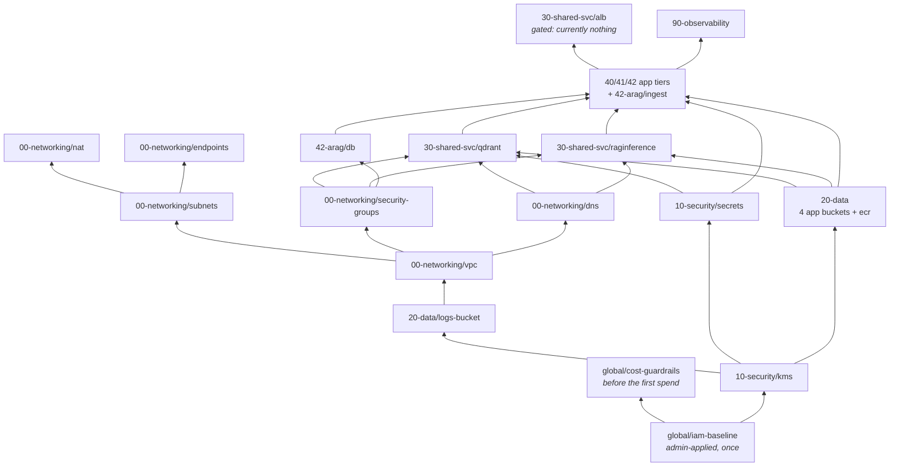

# Infrastructure walkthrough — the `dev` estate, inside out

A narrative tour of what this repository actually provisions in AWS, and **why each
piece is built the way it is**. Written for someone who knows AWS services in
general terms — "I know what a VPC, an ALB and an S3 bucket are" — but who has not
lived inside Terraform, Terragrunt, or the provisioning conventions this project
follows.

It is a *walkthrough*, not a reference. It follows the estate from the inside out
in the same order it was built and the same order it must be applied: the network
container first, then the keys that encrypt things, then the stores, then the
shared services, then the applications on top, and finally the scheduling and
detection that keep the bill and the failures honest.

Every claim here is drawn from the code in [`../../infra/`](../../infra/) as it
stands. Where a number appears (a cost, an instance size, a cron window) it comes
from the component that sets it, and the file is linked so you can check.

---

## Contents

| Layer | Document | What it covers |
|---|---|---|
| — | **[Foundations](infra-walkthrough-foundations.md)** | Terraform vs Terragrunt, remote state, the dependency graph, `default_tags`, naming, the three AWS identities, and the command loop |
| `00-networking` | **[Networking](infra-walkthrough-networking.md)** | VPC, subnets and route tables, the NAT *instance*, the S3 gateway endpoint, tier security groups, private Cloud Map DNS |
| `10-security` | **[Security](infra-walkthrough-security.md)** | The CMK and its key policy, secret *containers* without values, the Terraform execution role and its permissions boundary |
| `20-data` | **[Data stores](infra-walkthrough-data.md)** | The one secure-by-default S3 module and its five buckets, the twelve ECR repositories |
| `30-shared-svc` | **[Shared services](infra-walkthrough-shared-services.md)** | Self-hosted Qdrant on EC2, RagInference on Fargate, and the ALB that is switched *off* |
| `40/41/42` | **[Application tiers](infra-walkthrough-app-tiers.md)** | The `ec2-app` compose-host pattern, MacroRAG, XbrlRag (+ RDS + ingest runner), Faultline |
| `90` + `global` | **[Scheduling, observability, cost](infra-walkthrough-scheduling-observability.md)** | EventBridge Scheduler, where a schedule must live, the ops alert channel, budgets and anomaly detection |

Operational commands for running what is already built live in
[`../runbooks/day2-operations.md`](../runbooks/day2-operations.md). This
walkthrough explains the *shape* of the estate; that runbook is the day-to-day
keyboard.

### How the layers depend on each other

Apply order is bottom-up, and it is derived from these arrows rather than written
down anywhere — each component declares its dependencies and Terragrunt walks the
graph.



Two things that look out of order and are not. **`20-data/logs-bucket` is applied
before `00-networking`** despite the numbering, because VPC flow logs need a
destination bucket that is already encrypted, private, TLS-only and lifecycled — and
that posture should be written once in the S3 module rather than duplicated inside
the VPC module. And **`30-shared-svc/alb` depends on the application tiers** rather
than the reverse, because it registers them as targets; that is why a
networking-shaped resource sits in the shared-services layer.

---

## The estate in one page

**One AWS account. One region (`us-east-1`). One VPC per logical environment.**
`dev`, `staging` and `prod` are not separate accounts — they are separated by name
prefix (`genai-dev-*`), tags, and their own VPC CIDR. Today only `dev` exists as a
real environment; `staging` and `prod` are empty scaffold directories.

**No managed AI services.** There is no Bedrock, no SageMaker, no OpenSearch
Serverless, no EKS. "AI" here means external LLM APIs called over HTTPS, plus
self-hosted models (a BGE-M3 embedder and a Jina reranker on CPU Fargate) and a
self-hosted Qdrant vector store. That finding — recorded in
[`../design/aws-service-consolidation.md`](../design/aws-service-consolidation.md)
§1 — is why the estate looks like EC2 + Docker Compose rather than a managed-AI
architecture: the four workloads never asked for one.

**Compute and networking are the entire bill.** The data is tiny (Faultline's
whole tree is 36 MB; RagInference's model weights are ~4 GB). So every cost
decision in the estate is about *hours of compute* and *per-GB egress*, not
storage.

**Consequently: almost nothing runs 24×7.** The NAT instance runs 10:00–22:00 ET,
the four EC2 tiers 11:00–21:00, the XbrlRag database 10:45–21:10 (deliberately
bracketing its app tier, because RDS takes ~8 minutes to become `available`), and
RagInference scales its Fargate task 1↔0 on the same 11:00–21:00 window. What
bills around the clock is EBS volumes, S3, one KMS key, four secrets, and a
Route 53 private zone.

```
                    Internet
                       │
                  ┌────┴─────┐
                  │   IGW    │            (free; grants nothing on its own)
                  └────┬─────┘
        ┌──────────────┴───────────────┐  VPC 10.10.0.0/16
        │  public /20 × 2 AZ           │
        │    └─ NAT instance t4g.nano  │  ← 10:00–22:00, source_dest_check=false
        │                              │
        │  private /20 × 2 AZ          │
        │    ├─ qdrant     t4g.small   │  qdrant.genai-dev.internal:6333 (TLS)
        │    ├─ macrorag   t4g.small   │  macrorag.genai-dev.internal:8000
        │    ├─ arag       t4g.small   │  arag.genai-dev.internal:8000
        │    ├─ qlp        t4g.large   │  (calls the two above; publishes no name)
        │    ├─ arag-ingest t4g.medium │  usually STOPPED; operator-driven
        │    ├─ RDS PG16   db.t4g.micro│  genai-dev-arag, TLS enforced
        │    └─ Fargate 8vCPU/16GB     │  raginference.genai-dev.internal:8799
        │                              │
        │  S3 gateway endpoint (free)  │  ← ECR layer pulls bypass the NAT here
        └──────────────────────────────┘
                       │
              SSM Session Manager        ← the ONLY way in. No SSH, no key pairs,
              (agent dials outbound)        no public IPs, no load balancer today.
```

Nothing in that diagram is reachable from the internet. There is no bastion and no
SSH rule anywhere in the repository; administrative access and even *UI* access is
a Session Manager port-forward from a laptop. The shared ALB exists as code but is
switched off — see [Shared services](infra-walkthrough-shared-services.md#3-the-alb-that-is-currently-nothing).

---

## Two vocabularies you need before reading further

Most of the confusion for a newcomer is not AWS — it is that two tools with
similar-looking files do different jobs.

**Terraform** owns *resources*. A Terraform **module** is a folder of `.tf` files
describing AWS resources and the inputs they take. In this repo every reusable
piece of logic lives in [`../../infra/modules/`](../../infra/modules/) and nowhere
else. A module knows nothing about `dev` or `prod`.

**Terragrunt** owns *composition and state*. A Terragrunt **component** is a
folder containing a single `terragrunt.hcl` that says "instantiate *this* module,
with *these* inputs, and keep its state at *this* key". Components live in
[`../../infra/environments/`](../../infra/environments/) and contain **no resource
blocks at all**. They are wiring, plus a comment block explaining the decision and
the cost.

So a single piece of infrastructure is always two files worth reading:

```
infra/modules/networking/nat-instance/main.tf        ← WHAT a NAT instance is
infra/environments/dev/00-networking/nat/terragrunt.hcl   ← THIS dev NAT's inputs
```

The mechanics — how state keys are derived, how components depend on each other,
why `plan` works before a dependency exists — are all in
**[Foundations](infra-walkthrough-foundations.md)**. Read that first if any of the
HCL below looks like magic.

---

## The component inventory

Every applied component, in dependency order. "Module" is the Terraform module it
instantiates; the folder is under `infra/environments/`.

### `global` — account-wide, not tied to an environment

| Component | Module | Creates | Cost |
|---|---|---|---|
| `global/iam-baseline` | `security/iam-terraform-role` | The `genai-terraform-exec` role, its five scoped policies, the `genai-app-boundary` permissions boundary, and the thin `tfuser` | $0 |
| `global/cost-guardrails` | `cost/budgets` | SNS cost topic, a $150/month budget alerting at 50/80/100% actual + 100% forecast, and a Cost Anomaly Detection monitor | ~$0 |

`iam-baseline` is the **only** component applied by a human admin — the exec role
cannot create itself, and its own guardrail denies `iam:*User*` so it can never
create the `tfuser` either.

### `dev/00-networking`

| Component | Module | Creates | Cost |
|---|---|---|---|
| `vpc` | `networking/vpc` | VPC `10.10.0.0/16`, Internet Gateway, the default SG **stripped to deny-all**, VPC flow logs → S3 in Parquet | <$1/mo |
| `subnets` | `networking/subnets` | Public + private `/20` in two AZs, one shared public route table, **one private route table per AZ** | $0 |
| `nat` | `networking/nat-instance` | `t4g.nano` NAT instance, its SG and role, `0.0.0.0/0` routes to its **ENI** | ~$7.31/mo running, ~$0.64 stopped |
| `endpoints` | `networking/endpoints` | S3 **gateway** endpoint on every route table, with a write-vs-read endpoint policy | $0 |
| `security-groups` | `networking/security-groups` | Five tier groups — `alb`, `app`, `raginference`, `qdrant`, `rds` — and every rule between them, by group reference | $0 |
| `nat-schedule` | `scheduler/eventbridge` | Start 10:00 / stop 22:00 ET for the NAT | ~$0 |
| `dns` | `networking/dns` | Cloud Map private DNS namespace `genai-dev.internal` | ~$0.50/mo |

### `dev/10-security`

| Component | Module | Creates | Cost |
|---|---|---|---|
| `kms` | `security/kms` | One customer-managed key, `alias/genai-dev-primary`, annual rotation, a `kms:ViaService`-confined key policy | ~$1/mo |
| `secrets` | `security/secrets` | Four secret **containers** (`macrorag`, `qdrant`, `arag`, `qlp`) with per-secret reader policies — and deliberately **no values** | $1.60/mo |

### `dev/20-data`

| Component | Module | Creates | Cost |
|---|---|---|---|
| `logs-bucket` | `data/s3` | The log archive; 90-day expiry; accepts AWS log delivery | cents |
| `macrorag-corpus` | `data/s3` | MacroRAG corpus + its deploy bundle | <$0.10/mo |
| `raginference-weights` | `data/s3` | ~4 GB of model weights | ~$0.10/mo |
| `arag-filings` | `data/s3` | Raw SEC filings + XbrlRag's deploy bundle and image pointer | <$0.10/mo |
| `qlp-data` | `data/s3` | Faultline's data-tree backup + deploy bundle | <$0.10/mo |
| `ecr` | `registry/ecr` | **12** repositories, immutable tags, scan-on-push, KMS-encrypted, lifecycle-bounded | ~$0.30–0.60/mo |

### `dev/30-shared-svc`

| Component | Module | Creates | Cost |
|---|---|---|---|
| `qdrant` | `data/qdrant` | `t4g.small` Qdrant host, separate 20 GB CMK data volume, self-signed TLS, Cloud Map A record | ~$8/mo |
| `qdrant-schedule` | `scheduler/eventbridge` | 11:00–21:00 ET window for Qdrant | ~$0 |
| `raginference` | `compute/ecs-service` | Fargate ARM64 service (8 vCPU / 16 GB), two least-privilege roles, Cloud Map registration, CPU+memory alarms, scheduled 1↔0 | ~$95/mo on the window |
| `alb` | `edge/alb` | **Nothing today** — gated on `ingress_mode` in `env.hcl`, currently `"ssm"` | $0 (would be $16.43/mo) |

### `dev/40…42` — the application tiers

| Component | Module | Creates | Cost (scheduled) |
|---|---|---|---|
| `40-quantlibpricer/app` | `compute/ec2-app` | `t4g.large` + 10 GB data volume; three-container compose stack; calls XbrlRag and MacroRAG east-west | ~$23.6/mo |
| `41-macrorag/app` | `compute/ec2-app` | `t4g.small` + 20 GB data volume; four-container stack; S3 corpus | ~$22.56/mo |
| `42-arag/db` | `data/rds` | PostgreSQL 16 `db.t4g.micro`, CMK, `rds.force_ssl=1`, AWS-managed rotating master secret, 10:45–21:10 window | ~$5.05/mo + $2.30 storage |
| `42-arag/app` | `compute/ec2-app` | `t4g.small`, **stateless** (facts in RDS, vectors in Qdrant) | ~$22.56/mo |
| `42-arag/ingest` | `compute/ingest-runner` | `t4g.medium` operator-driven batch box, normally **stopped** | ~$0.034/hr while running |

### `dev/90-observability`

| Component | Module | Creates | Cost |
|---|---|---|---|
| `alerts` | `observability/alerts` | The `genai-dev-ops-alerts` SNS topic, TLS-only, CloudWatch-publish-only | $0 |
| `scheduler-alarms` | `observability/scheduler-alarms` | Alarms on `TargetErrorCount` and `InvocationDroppedCount` for every schedule in the estate | $0.20/mo |

Six module directories are deliberate stubs with no consumer:
`compute/{job-runner,lambda}`, `messaging/sqs`, `data/{backup,dynamodb}`,
`security/guardrails`. They carry a README explaining what they would be for.

---

## The five principles that explain most of the code

If a design choice in this repo looks strange, it is almost always one of these
five. They are written out in full in [`../../CLAUDE.md`](../../CLAUDE.md); this is
the short version, because you will meet each of them in every layer document.

**1. One service at a time.** A change provisions exactly one AWS service, then
verifies it, then commits. That is why the VPC component creates *no* subnets, the
subnets component creates *no* NAT route, and the NAT arrives in its own change
with the schedule in yet another. A `plan` that touches resources outside the
service under construction means the change is too big.

**2. Tests are real, never mocked.** Two kinds exist and they answer different
questions. Module-level `*.tftest.hcl` files are plan/apply-time tests against a
*mocked* provider — they prove the module's posture holds for any inputs, with no
AWS credentials:

```bash
# Prove the Qdrant module always produces a private, encrypted, discoverable host
terraform -chdir=infra/modules/data/qdrant test
```

Then [`../../tests/integration/`](../../tests/integration/) queries the **live AWS
API** after an apply and asserts on what really exists — 28 modules of it. An
`apply` succeeding only means Terraform got a 200; it does not mean the resource is
configured correctly.

```powershell
$env:AWS_PROFILE = "genai-tf"
task verify          # pytest tests/integration -m integration -v
```

**3. Security is enforced by a check, not by a convention.** Encryption at rest
(CMK) and in transit (`aws:SecureTransport` deny), public access blocked, no
`0.0.0.0/0` ingress, least-privilege IAM scoped by ARN, everything logged with an
explicit retention. Where a control is *deliberately relaxed* — and several are, in
dev — the module README says so, names the compensating control, and a test pins
the relaxation so it cannot spread silently.

**4. Cost is a design input.** Serverless or schedulable first; every always-on
line item needs a written reason; Graviton (`arm64`) everywhere; a lifecycle rule
on everything that accumulates. Each component's header comment states its
estimated monthly cost — "cheap" is not a number.

The estate is a **demo environment**, so it also has an off switch: `parked = true`
in [`../../infra/environments/dev/env.hcl`](../../infra/environments/dev/env.hcl)
holds every compute tier down indefinitely — roughly $4/day to $0.68/day — while
keeping every volume, image, secret, DNS name and ingested row exactly where it is.
Waking up is a flag flip and an apply, never a re-provision. The three tiers park by
different mechanisms and RDS is the counter-intuitive one (AWS force-starts a stopped
database after seven days, so it parks with a *stop-only* schedule rather than by
disabling its schedules); see
[Scheduling §6](infra-walkthrough-scheduling-observability.md#6-what-actually-costs-money-and-the-levers)
and [the runbook §11](../runbooks/day2-operations.md#11-park-the-environment-and-wake-it-up).

**5. A deploy is not a provision.** Shipping a new container image must never
replace the infrastructure that runs it. **No image tag appears anywhere in
Terraform.** Tags live in an S3 object the host reads at boot (`deploy.env`) or on
every run (an image-pointer object), so a version bump is `upload + restart`, with
no `terraform apply` and no instance replacement. This is covered in detail in
[Application tiers](infra-walkthrough-app-tiers.md#image-tags-live-in-s3-not-in-terraform).

---

## The command loop

Everything routes through [`../../Taskfile.yml`](../../Taskfile.yml), so the same
four commands work for every layer. `task` only resolves from the repository root.

```powershell
# 0. Which AWS identity am I? There is deliberately NO [default] profile, so an
#    unpinned command fails with NoCredentials instead of silently running as admin.
$env:AWS_PROFILE = "genai-tf"
task whoami         # must print assumed-role/genai-terraform-exec/...

# 1. Local gate: ruff + mypy + pytest (unit), and `terraform fmt -check`.
task ci

# 2. Policy-as-code over the real modules (checkov, via uvx so it cannot
#    downgrade the shared conda env).
task policy

# 3. Plan the whole environment. `run --all` walks the dependency graph, so
#    components are planned in the right order and outputs flow between them.
task plan ENV=dev

# 4. Apply, then IMMEDIATELY verify against live AWS.
task apply ENV=dev
task verify
```

`task plan`, `task apply` and `task verify` each **self-guard on the resolved STS
ARN** and refuse to run unless you are the exec role — a wrong `AWS_PROFILE` is
rejected rather than silently applied. `task iam-baseline` guards the other way: it
refuses to run *as* the exec role, because that component must be applied by an
admin.

For a single component — which is the normal unit of work — call Terragrunt
directly in its folder:

```powershell
# The one-service-at-a-time loop, for one component
cd infra/environments/dev/00-networking/nat
terragrunt plan     # READ the diff, don't skim
terragrunt apply

# What did it publish for other components to consume?
terragrunt output

# What does this component own? (Useful before a destroy or a refactor.)
terragrunt state list
```

Any `destroy` or `replace` in a plan stops the work and gets raised with a human
before the apply. That is not a formality: several resources here
(`user_data_replace_on_change = true` on the app hosts) will replace an instance
for what looks like a config edit.

Formatting is checked in `task ci` and by pre-commit:

```powershell
terraform -chdir=infra fmt -recursive          # .tf files
terragrunt hcl fmt                             # .hcl files (Terragrunt)
```

---

## What is deliberately relaxed in `dev`

Stated plainly here so nobody discovers it by surprise, and so the list stays
short. Each is written up with its compensating control in the module README, and
each is a prod-hardening item.

| Relaxation | Compensating control today | Where |
|---|---|---|
| **No TLS on the shared ALB** (no registered domain ⇒ ACM cannot issue) | The ALB is internal *and* currently destroyed; dev carries no real data | [`edge/alb`](../../infra/modules/edge/alb/README.md) |
| **Qdrant API-key auth off** | TLS on, private subnet, no public IP, SG-to-SG ingress only, no real data | [`data/qdrant`](../../infra/modules/data/qdrant/README.md) |
| **One shared `app` security group**, so any app host can reach any other on 8000 | Exactly one TCP port, private subnets only, no CIDR rules; dev's app tier is one trust domain | [`networking/security-groups`](../../infra/modules/networking/security-groups/main.tf) |
| **A single-point-of-failure NAT instance** instead of a NAT Gateway | Acceptable in dev; prod keeps the Gateway | [`networking/nat-instance`](../../infra/modules/networking/nat-instance/README.md) |
| **RDS single-AZ, no deletion protection, `skip_final_snapshot`** | The database is *derived* state — facts and MVs re-ingest from the durable S3 filings | [`data/rds`](../../infra/modules/data/rds/README.md) |
| **No S3 server-access logging** on the data buckets | Block-public-access, SSE-KMS, TLS-enforced policy, ARN-scoped roles, account CloudTrail | each `20-data` component |
| **No interface VPC endpoints** (SSM/ECR/Logs ride the NAT) | ~$22/month for three, against pennies of NAT data at dev volume | [design §2a](../design/aws-service-consolidation.md) |
| **Container Insights and detailed EC2 monitoring off** | $2.10/instance/month for 1-minute metrics on hosts stopped 14 h/day | the compute modules |

---

## Where to go next

- Never touched Terragrunt → **[Foundations](infra-walkthrough-foundations.md)**
- Want to understand reachability, DNS, or why a request times out →
  **[Networking](infra-walkthrough-networking.md)**
- Reviewing IAM or encryption → **[Security](infra-walkthrough-security.md)**
- Adding a bucket or a container repository → **[Data stores](infra-walkthrough-data.md)**
- Consuming Qdrant or RagInference from an app →
  **[Shared services](infra-walkthrough-shared-services.md)** and the task-focused
  [`consuming-shared-services.md`](consuming-shared-services.md)
- Deploying or debugging an application →
  **[Application tiers](infra-walkthrough-app-tiers.md)** then
  [`../runbooks/day2-operations.md`](../runbooks/day2-operations.md)
- Chasing a cost line or a schedule that did not fire →
  **[Scheduling, observability, cost](infra-walkthrough-scheduling-observability.md)**

The holistic record of *why* — including options considered and rejected — is
[`../design/design-decisions.md`](../design/design-decisions.md) and
[`../design/aws-service-consolidation.md`](../design/aws-service-consolidation.md).
Auto-derived diagrams of the live estate are in
[`../diagrams/auto-derived/`](../diagrams/auto-derived/).
